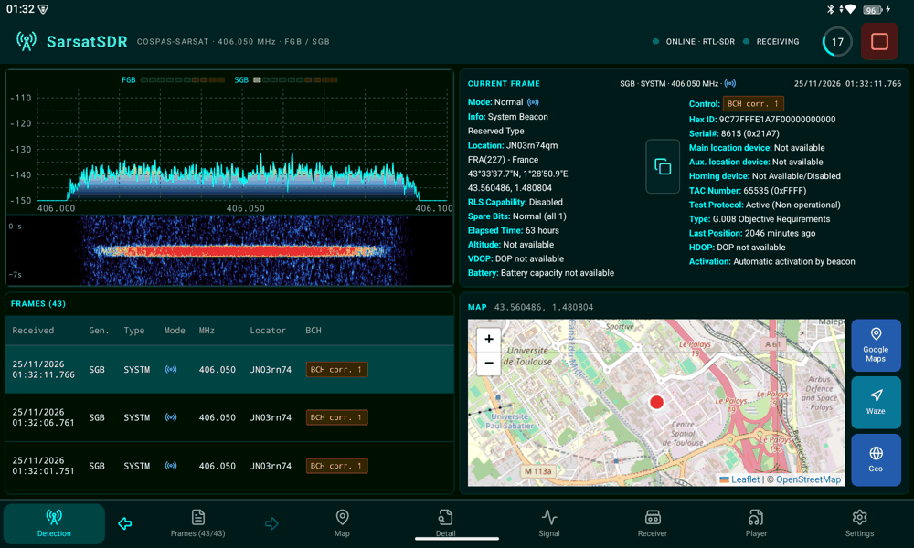
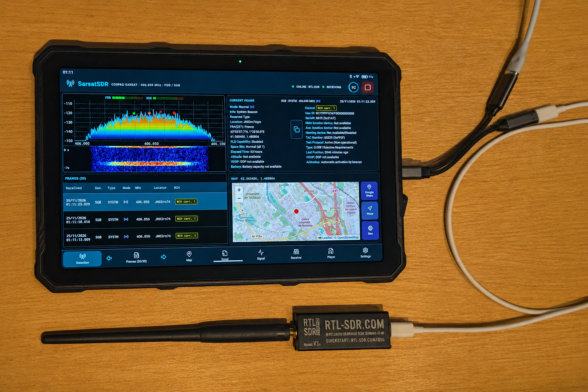
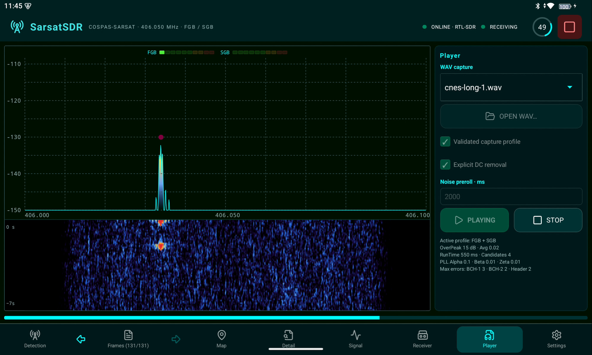
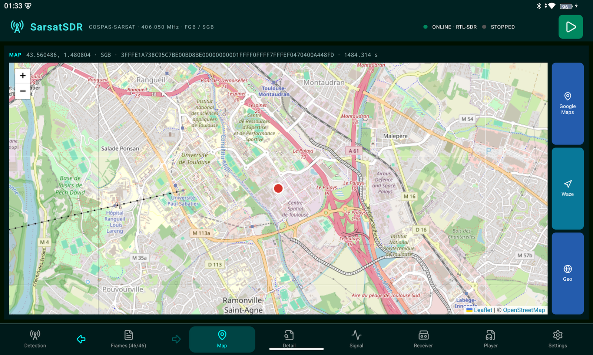
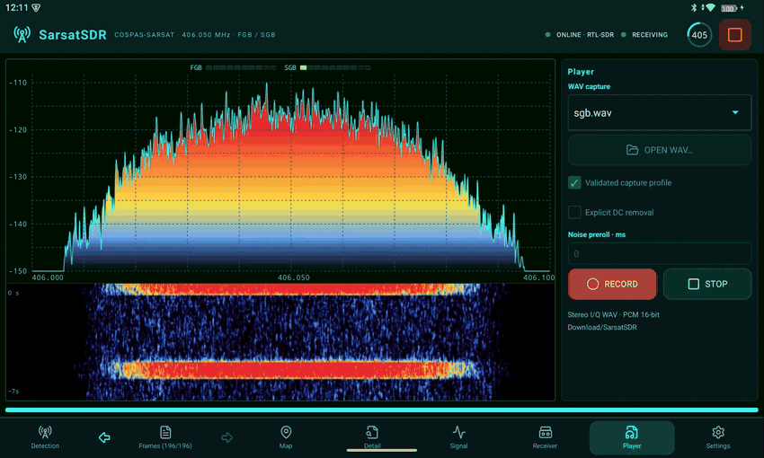

# 📡 SarsatSDR

**Receive and decode COSPAS-SARSAT 406 MHz emergency beacons with an RTL-SDR dongle.**

SarsatSDR turns your Android tablet and RTL-SDR receiver into a live
COSPAS-SARSAT 406 MHz decoding station. It brings the radio spectrum,
decoded messages, beacon details, and a map together in one landscape dashboard.

Both first-generation (FGB) and second-generation (SGB) beacons are supported.
No receiver at hand? Explore the app with the included sample recordings.

[Android releases](https://github.com/fredzo/SarsatSDR/releases)

*Live reception in the Detection dashboard on an Android tablet.*

## ✨ What you can do

- **See bursts as they happen.** A live spectrum and scrolling waterfall reveal
  incoming signals, with peaks that fade slowly enough to inspect.
- **Decode both beacon generations.** Read beacon identification, position when
  available, reception time, frequency, and error-correction status. Normal and
  self-test modes can be selected independently.
- **Keep the whole picture in view.** The Detection dashboard combines the
  signal, frame list, selected message, and map without switching screens.
- **Explore reported positions.** View them on OpenStreetMap, then open
  Google Maps, Waze, or a compatible map app through the Geo link.
- **Listen and follow the next burst.** FGB FM audio, distinct frame
  notifications, and an adjustable countdown help you monitor reception.
- **Record and replay.** Save live I/Q recordings on Android, replay included
  samples, or open your own compatible WAV captures.
- **Keep your reception sessions.** Automatically save the latest 200 frames
  per acquisition day, reopen past sessions, and download them as JSON.
- **Inspect and share.** Examine signal traces, or copy and share decoded
  hexadecimal data and links.

For a screen-by-screen walkthrough, numbered screenshots, and animated examples,
see the [detailed application guide](docs/README.md).

## 🔌 What you need

### 📡 For live reception

- An Android device running **Android 8.0 or later**, with USB host/OTG support.
  The interface is designed for tablets in landscape orientation.
- A compatible **[RTL-SDR USB receiver](https://www.aliexpress.com/item/1005009176860935.html)**: R820T, R820T2, R828D, or RTL-SDR Blog V4.
- A suitable antenna for **406 MHz** and a USB OTG adapter or cable if needed.
- *Optional:* The RTL-SDR dongle tends to draw a significant amount of power from the tablet. A [USB splitter](https://www.aliexpress.com/item/1005008284832946.html) can be used to power the tablet while keeping the dongle connected.

Android builds support `arm64-v8a` and `x86_64`. Live I/Q recording requires
**Android 10 or later**.

SarsatSDR also runs on Windows through a local browser interface.
Windows setup is covered in the developer guide linked below.

### ▶️ Try the app without a receiver

Just install the Android app and use the bundled recordings.
Reception, local decoding, and bundled sample playback work offline.
Map tiles and external services require Internet access.

## 🚀 Get started

### 📲 Install on Android

1. Check [GitHub Releases](https://github.com/fredzo/SarsatSDR/releases) for
   available APKs and download the one you want to install.
2. Open the APK on your device. Android requires permission to **install apps
   from external sources** for the browser or file manager opening the APK.
   Follow the [illustrated permission guide](docs/ANDROID_INSTALL.md), then
   return to the APK and tap **Install**.
3. Launch **SarsatSDR** and use the device in landscape orientation.

Current APKs use a debug signing key and are intended for testing.

### ▶️ Try a recording first

1. Open **Player**.
2. Select a bundled capture, such as `fgb.wav`, and keep the validated playback
   profile enabled.
3. Tap **PLAY**. Watch the spectrum and decoded frames arrive in real time.
4. Open **Detection**, **Frames**, or **Map** to explore the results.

Use **OPEN WAV** on Android to replay your own stereo I/Q recordings.
Supported formats are 8-bit PCM, 16-bit PCM, and 32-bit floating-point WAV.

### 📡 Receive live signals

1. Connect the RTL-SDR receiver and antenna to your Android device.
2. Grant USB access when prompted.
3. In **Receiver**, keep the default center frequency of **406.050 MHz** or
   choose the frequency you want to monitor.
4. Tap the green start button in the header.
5. Watch **Detection** for incoming bursts and decoded messages. Tap the red
   stop button when finished.

If several receivers are connected, select the device in **Settings**.

## 🧭 Find your way around

| Tab | What it is for |
|---|---|
| **Detection** | Your live dashboard: spectrum, waterfall, messages, details, and map. |
| **Frames** | Browse received messages and inspect their decoded fields. |
| **Map** | Explore positions reported by beacons and open navigation links. |
| **Detail** | Open the selected message in an external COSPAS-SARSAT decoder. |
| **Signal** | Zoom into FGB phase or SGB I/Q traces and inspect individual bits. |
| **Receiver** | Adjust frequency, decoder modes, spectrum, and waterfall. |
| **Player** | Replay WAV captures or record the live I/Q stream on Android. |
| **Settings** | Configure filtering, audio, countdown, and RTL-SDR settings. |

Invalid and system frames are hidden by default. Change **Filtering** in
Settings to show them; filtering does not delete received frames.
Your settings are remembered between launches, while the connected USB
receiver is selected afresh at startup.

## ⏺️ Keep a recording for later

During live RTL-SDR reception, the Player button changes from **PLAY** to
**RECORD**. Tap it to start a WAV recording; **RECORDING** and a scrolling red
progress bar confirm that recording is active.

Captures are saved under `Download/SarsatSDR` as
`capture-DD-MM-YYYY_HH-mm-ss.wav`. Tap **STOP** once to finish the recording
without stopping reception, or again to stop reception too.

Open the saved file later with **OPEN WAV** to replay it.
Each recording is limited to 4 GiB, approximately 19 minutes.

## 🛠️ For developers

See [DEVELOPER_README.md](DEVELOPER_README.md) for the technical description,
project layout, prerequisites, step-by-step Windows and Android build
instructions, headless decoding, C API, tests, and GitHub build/release workflows.

## ⚠️ Limitations and distribution

Pause/seeking, iOS integrations, and network/SigMF sources remain to be completed.
WAV files are still loaded in full; USB reception uses bounded queues.
Capture regressions do not replace RF measurements of sensitivity,
false positives, and endurance.

## 📄 License

This project is distributed under the GNU General Public License
version 3.0 or later (`GPL-3.0-or-later`).

The Android application statically links FFTW and therefore constitutes
a combined work distributed under GNU GPL version 3 or later.

Third-party components remain subject to their respective licenses,
including libusb under LGPL-2.1-or-later, Lucide under ISC/MIT, and
Leaflet under BSD-2-Clause.

See [LICENSE](LICENSE) for the full text.

Third-party components retain their respective licenses.
See [THIRD_PARTY_NOTICES.md](THIRD_PARTY_NOTICES.md).
