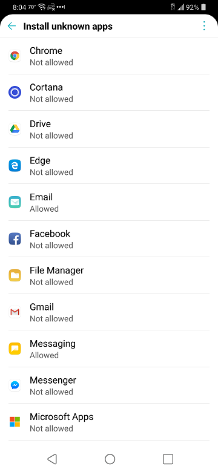

# 📲 Allow APK installation on Android

[Back to the project README](../README.md)

SarsatSDR is distributed as an APK through
[GitHub Releases](https://github.com/fredzo/SarsatSDR/releases), rather than
Google Play. Android therefore requires permission to install apps from
**external sources**, also called **unknown sources**.

On Android 8.0 and later, this permission applies to the **app opening the APK**,
not to the whole device. For example, authorize Chrome if you open the download
in Chrome, or Files / File Manager if you open it there. Downloading with Chrome
and then opening the APK in Files requires permission for **Files**.
You do not grant this permission to SarsatSDR itself.

## 🔓 Allow installation when prompted

1. Download the SarsatSDR APK from the project's GitHub Releases page.
2. Open the downloaded APK. If Android reports that this source cannot install
   unknown apps, tap **Settings** in that message.
3. Check that the settings page names the browser or file manager you used,
   then enable **Allow from this source**. Depending on the device, the label
   may instead be **Allow app installs**.
4. Go **Back** to the installer, or reopen the downloaded APK. Tap **Install**,
   wait for installation to finish, then tap **Open**.

You do not need root access, Developer options, or USB debugging.

## ⚙️ Find the permission manually

If Android does not offer a Settings shortcut:

1. Open the device's **Settings** app.
2. Search Settings for **Install unknown apps**. A common path is
   **Apps > Special app access > Install unknown apps**. Some devices use
   **Apps & notifications > Special access**, or place the option under
   **Security**.
3. Select the app that opens your APK, such as **Chrome** or **File Manager**.
4. Enable **Allow from this source**, then return to the APK and install it.

*Example: the app-selection screen on an LG G7 running Android 8 (Oreo).
Choose the app you actually use; do not enable every entry. Tap its row to
reach the permission switch. Menu names and appearance vary by Android version
and manufacturer.*

Screenshot by [Bruce Dimon](https://android.stackexchange.com/users/270310/bruce-dimon),
from [“Why would I enable ‘Install Unknown Apps?’”](https://android.stackexchange.com/questions/201491/why-would-i-enable-install-unknown-apps)
on Android Enthusiasts Stack Exchange, licensed under
[CC BY-SA 4.0](https://creativecommons.org/licenses/by-sa/4.0/).
Reproduced unchanged; this license applies to the screenshot.

## 🔒 After installation

- Turn **Allow from this source** off again for that browser or file manager
  when you no longer need it. SarsatSDR will keep working.
- To install a later APK update, temporarily allow the same source again.
- Download APKs only from sources you trust. Keep **Google Play Protect**
  enabled; this permission does not require disabling it.

## 🧩 If installation is still blocked

- **The installer asks again:** check which app opened the APK. Permission for
  the browser does not also authorize the file manager.
- **The switch is missing or greyed out:** a managed device, work profile,
  parental control, or device security policy may prohibit external installs.
  Ask the device administrator or consult the manufacturer's instructions;
  do not try to bypass an enforced policy.
- **Android reports an unsafe app:** stop and verify the download and warning.
  Do not disable device protection merely to dismiss it.

See Google's guidance on
[downloading apps from other sources](https://support.google.com/android/answer/9457058?hl=en)
and [Google Play Protect](https://support.google.com/android/answer/2812853?hl=en)
for the associated security checks.
