# 📖 SarsatSDR application guide

Receive, inspect, map, and replay COSPAS-SARSAT 406 MHz beacon signals.
This guide covers the Android tablet interface, one screen at a time.
The Windows browser interface shares the same tabs; USB permissions, file
pickers, sharing, and recording differ where noted.

The screenshots were taken on a real Android tablet. They show test/system
traffic and bundled recordings, not confirmed distress events. Their settings
are examples, not necessarily the factory defaults. Yellow numbers identify
the controls described alongside each image. Click an image to open it at full
size. The GIFs are real screen captures; they have no sound.

[Project overview and installation](../README.md) |
[Developer guide and build instructions](../DEVELOPER_README.md)

## 🧭 Contents

- [First steps](#first-steps)
- [Detection and shared controls](#detection-and-shared-controls)
- [Frames](#frames)
- [Map](#map)
- [Detail](#detail)
- [Signal](#signal)
- [Receiver](#receiver)
- [Player](#player)
- [Settings](#settings)
- [Restoring defaults](#restoring-defaults)
- [Troubleshooting](#troubleshooting)

## 🚀 First steps

### ▶️ Try the app without a receiver

1. Open **Player** and choose a bundled WAV capture.
2. Leave **Validated capture profile** checked.
3. Tap **PLAY**, then open **Detection** to watch messages arrive.
4. Select a message in **Frames** to inspect it in the other tabs.

The bundled recordings can be decoded offline. Map tiles and the external
decoder in Detail require Internet access.

### 📡 Start live reception

1. Connect a compatible RTL-SDR receiver and 406 MHz antenna through USB OTG.
2. Grant Android USB access when prompted.
3. In **Receiver**, check the center frequency and desired decoder modes.
   The default center is **406.050 MHz**, displaying 406.000 to 406.100 MHz.
4. Tap the green triangle in the top-right corner to start.
5. Tap the red square to stop when finished.

Use **Settings > RTL-SDR > USB** if more than one receiver is connected.
The selected connected device is detected afresh at startup; its USB address
is not a saved preference. Decoder and hardware controls are generally locked
during an active session. Display, filtering, and audio controls have their own
availability rules; a dimmed control is currently unavailable.

## 📡 Detection and shared controls

Detection is the main monitoring dashboard. It keeps the signal, received
messages, selected frame, and map visible together.

<table>
<tr>
<td width="60%" valign="top"><a href="images/detection-guide.png">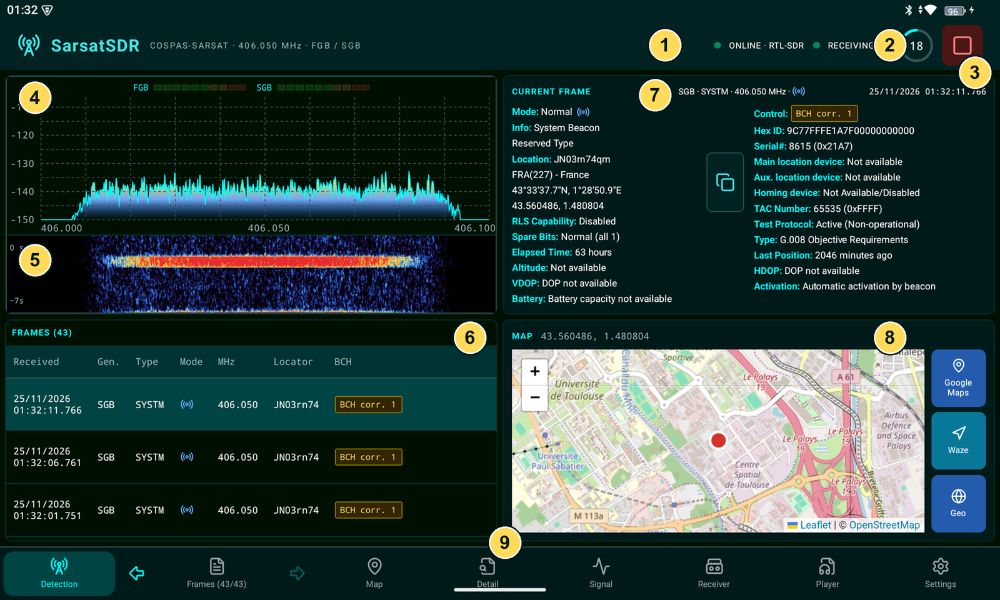</a></td>
<td valign="top">
<ol>
<li><strong>Connection and session status.</strong> ONLINE identifies the Android connection to the native service; it is not proof that a beacon is being received. RECEIVING means a session is running. STOPPED and RETRYING indicate an idle session or a receiver restart.</li>
<li><strong>Acquisition indicator and timer.</strong> The cyan arc rotates while processing runs. With FGB countdown enabled, the number is either the remaining countdown or the elapsed count.</li>
<li><strong>Start/stop reception.</strong> The green triangle starts the RTL-SDR receiver; the red square stops the active session. An active recording is finalized when reception stops.</li>
<li><strong>Spectrum and detection indicators.</strong> Frequency runs horizontally; level runs vertically. FGB candidate markers show acquisition attempts, not confirmed decodes. The FGB/SGB indicators report new detections.</li>
<li><strong>Waterfall.</strong> The newest signal history appears at the top and moves down. Brighter colors indicate stronger levels relative to the selected display settings.</li>
<li><strong>Received frames.</strong> Tap a row to select it. The highlight identifies the active message. The list includes generation, type, mode, frequency, locator when available, and BCH status.</li>
<li><strong>Current frame.</strong> The compact summary includes beacon identification, mode, country, reported position, and error-correction status. When a position exists, the copy button offers decimal coordinates, degrees/minutes/seconds, and locator.</li>
<li><strong>Map.</strong> Shows the selected message's position, or the most recent available position when the selection has none. Navigation buttons sit on its right edge.</li>
<li><strong>Bottom navigation.</strong> Switch tabs without stopping acquisition. Arrows beside Frames select the previous/next visible message; Frames (x/y) gives the selected position within the visible list.</li>
</ol>
</td>
</tr>
</table>

Each new unfiltered frame becomes the active selection. When filters hide some
messages, the frame-list heading can display visible/total counts.
Filtering does not delete stored messages.

### 🌊 Watch the waterfall

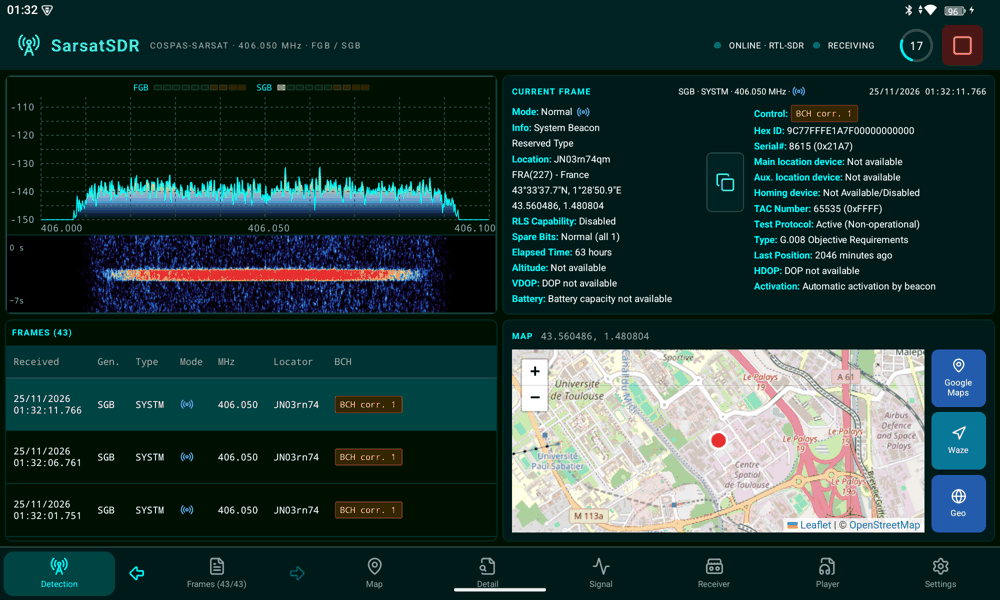

The spectrum attacks quickly and lets peaks decay toward the noise floor over
about three seconds. Its vertical range remains fixed at -150 to -110 dB;
stronger peaks are clipped visually rather than changing the scale.
Clipping at the top of this graph is **not** the same as saturation of the
receiver's analog-to-digital converter.

### ⏱️ Understand the FGB timer

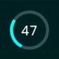

- With countdown enabled, each **unfiltered FGB frame** restarts the timer.
  The default duration is **50 seconds**; SGB frames do not restart it.
- Before the first qualifying frame, the timer counts up. After the countdown
  expires, it counts up again unless **Auto reload countdown** is enabled.
  The elapsed counter wraps after 999.
- With **Countdown beep** enabled, low beeps sound at 5, 4, 3, and 2 seconds,
  followed by a higher beep at 1 second.
- Long-press the timer to reset it to zero in count-up mode, with a double beep.
  This does not change the auto-reload preference. The next unfiltered FGB frame
  restarts the countdown.
- Turning off **FGB countdown** removes the numeric timer, not the rotating
  acquisition indicator.

Configure these options in [Settings](#settings). A countdown estimates a
repetition interval; it does not guarantee when another beacon burst will arrive.

## 📋 Frames

Use Frames to browse the reception history and inspect a message in more detail.

<table>
<tr>
<td width="60%" valign="top"><a href="images/frames-guide.png">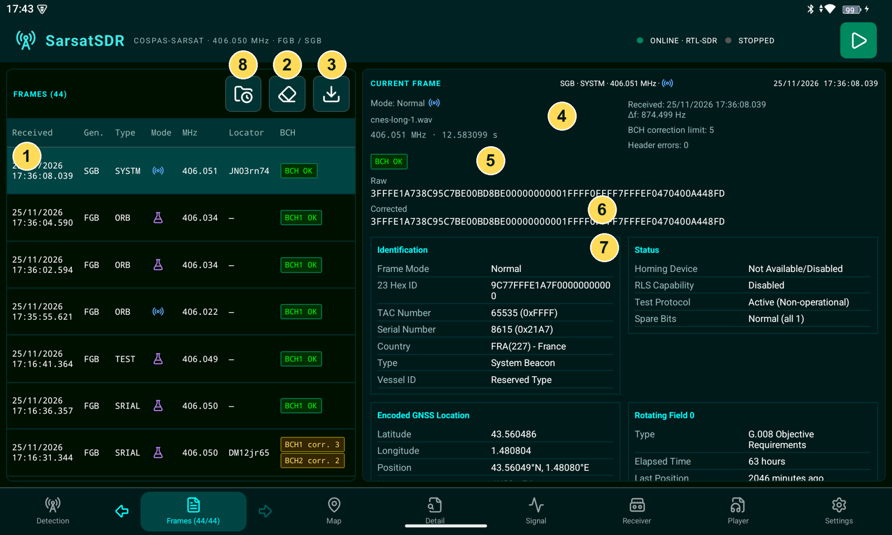</a></td>
<td valign="top">
<ol>
<li><strong>Frame table.</strong> Tap a row to select a message. Scroll vertically for older messages and horizontally when columns extend beyond the pane.</li>
<li><strong>Clear frames.</strong> Opens a confirmation dialog. Confirming removes all frames in today's loaded session, including currently filtered messages. It is disabled for a historical session; other days remain untouched.</li>
<li><strong>Export JSON.</strong> Exports the loaded session's messages, including hidden ones. On Android, choose a destination folder in the system file picker; the browser downloads a JSON file. Cancelling leaves the session unchanged.</li>
<li><strong>Reception metadata.</strong> Identifies the generation, source, mode, frequency, reception timestamp, source-relative time, and frequency offset. It also shows applicable correction limits and header errors.</li>
<li><strong>BCH badges.</strong> Green means no corrections were required; amber indicates corrections; red indicates failure or a configured limit exceeded. FGB can have separate BCH-1 and BCH-2 badges.</li>
<li><strong>Raw and corrected data.</strong> The original hexadecimal word and the word after BCH processing are shown separately. Text can be selected for copying.</li>
<li><strong>Decoded information groups.</strong> Identification, location, status, emergency information, and generation-specific fields are grouped by section. Scroll this pane independently of the table.</li>
<li><strong>Saved sessions.</strong> Opens the daily session manager. Available only when no live reception or WAV playback is active.</li>
</ol>
</td>
</tr>
</table>

The main information to look for is the beacon ID, beacon type, country,
reported coordinates, and correction status. Not every frame contains a
position or every possible field. "Not available" is different from a valid
zero value.

Each daily session holds up to **200 frames**. Dates throughout the app use
**DD/MM/YYYY**, including saved sessions and confirmation dialogs. Reception
timestamps use local time, with milliseconds; source-relative times are available in the details. New messages select
automatically, and selecting a row updates Map, Detail, and Signal.

The Mode column uses a compact **Hn** badge when an FGB header has mismatched
bits, where **n** is their count. Column spacing adapts to the pane width without
shrinking the text. The full header-error description remains available in the frame details.

An FGB short or orbitography frame may legitimately have no BCH-2 badge.
A corrected frame is not automatically invalid. Conversely, a BCH failure
means its decoded fields should not be treated as reliable.

### 🗂️ Saved sessions

The **folder-clock** button beside Clear frames opens the session manager.
Stop live reception or WAV playback first: session management is unavailable
during an acquisition.

<table>
<tr>
<td width="60%" valign="top"><a href="images/session-manager-guide.png">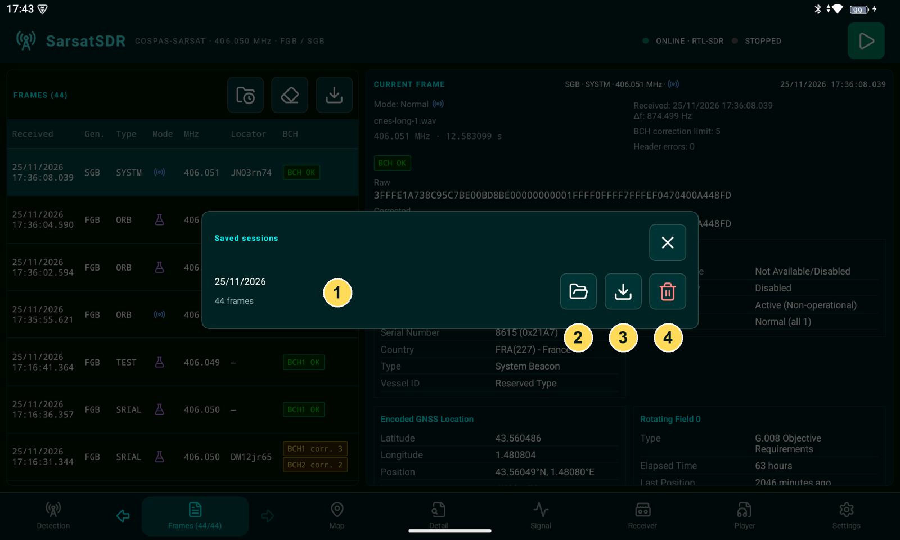</a></td>
<td valign="top">
<ol>
<li><strong>Date and frame count.</strong> Saved days are listed newest first, including messages hidden by display filters.</li>
<li><strong>Load.</strong> Opens this day's frames for browsing in Frames, Map, Detail, and Signal.</li>
<li><strong>Download.</strong> Exports this day's complete frame entries as a JSON file without changing the displayed session.</li>
<li><strong>Delete.</strong> Removes this day's internal history after confirmation. Cancel to leave it untouched.</li>
</ol>
</td>
</tr>
</table>

Sessions are saved automatically in the application's internal storage on
Android, or in this browser's local IndexedDB storage on Windows. The current
day is restored when the app opens. Both RTL-SDR reception and WAV playback
contribute to the same daily history, including frames hidden by display filters.
Complete decoded data and signal traces are retained.

- A session uses the device's **local calendar date when acquisition starts**.
  An acquisition continuing after midnight still belongs to its original day.
- Starting another acquisition on a different day loads or creates that day's
  session. Starting again on the same day appends to it, retaining its latest
  200 frames across stops and app restarts.
- A loaded historical day is identified by a small folder-clock icon and its
  date in the Frames header. Frame selection also updates Map, Detail, and Signal.
  Clear frames is disabled for historical days.
- Starting reception or playback automatically returns to today's session.
  Deleting the loaded session returns to today's history; deleting another
  session does not change the displayed frames.

Exports are named `sarsat-decodes-DD-MM-YYYY.json` and contain an array of complete
frame entries, with reception timestamps, source, center frequency, decoded data,
and traces. JSON timestamps retain machine-readable ISO 8601 format. Export does not remove frames. Uninstalling the app or clearing its
storage removes local sessions, so export anything you want to keep. In a browser,
clearing site data has the same effect; sessions belong to that browser and site
address.

## 🗺️ Map

Map gives the selected reported position more screen space.

<table>
<tr>
<td width="60%" valign="top"><a href="images/map-guide.png">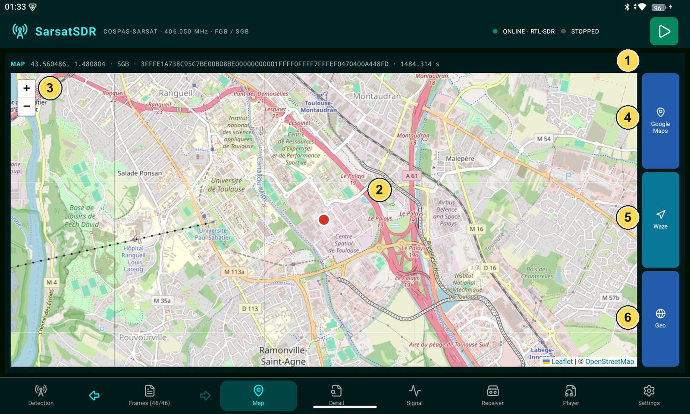</a></td>
<td valign="top">
<ol>
<li><strong>Position header.</strong> Shows decimal coordinates and identifies the message used for the map. Check this when browsing frames.</li>
<li><strong>Map and marker.</strong> The red marker is the position encoded by the beacon, not the tablet's GPS location. Drag to pan and pinch to zoom.</li>
<li><strong>Zoom buttons.</strong> Use + and - when you prefer buttons to pinch gestures.</li>
<li><strong>Google Maps.</strong> Opens the reported coordinates through a Google Maps link.</li>
<li><strong>Waze.</strong> Opens a Waze link for those coordinates.</li>
<li><strong>Geo.</strong> Opens a standard geo:latitude,longitude URI in a compatible installed application. Android may ask which application to use.</li>
</ol>
</td>
</tr>
</table>

If the selected frame has no position, the app may retain the most recent
position from another frame. If no decoded position exists, it displays
**No decoded beacon position**. The map uses OpenStreetMap tiles and needs
Internet access to load them.

### 🔗 Copy or share a map link

Long-press **any** of the three navigation buttons instead of tapping it.
This opens the same action menu for that button's URL.

<table>
<tr>
<td width="60%" valign="top"><a href="images/map-actions-guide.png">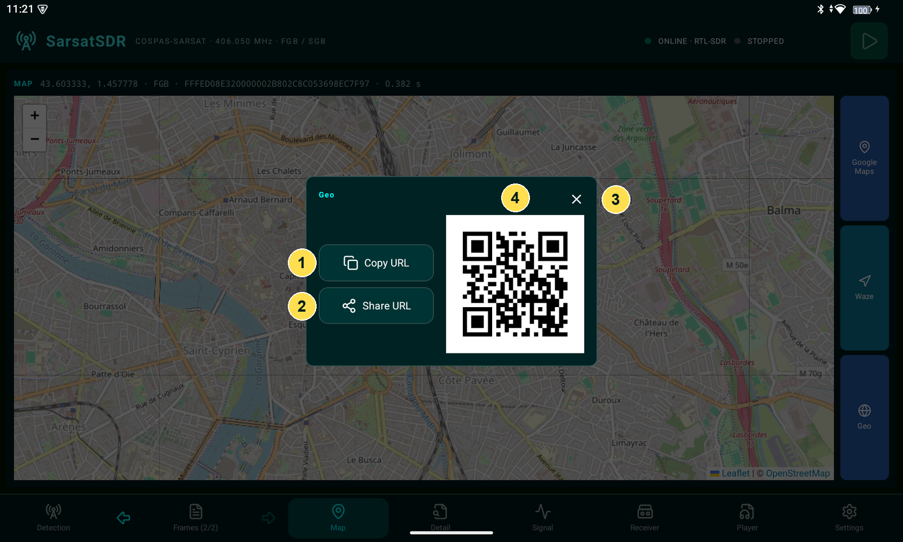</a></td>
<td valign="top">
<ol>
<li><strong>Copy URL.</strong> Copies the selected navigation link to the clipboard.</li>
<li><strong>Share URL.</strong> Opens Android sharing for that link.</li>
<li><strong>Close.</strong> Dismisses the menu without opening or sharing the link.</li>
</ol>
</td>
</tr>
</table>

For example, Geo produces a link such as `geo:43.560486,1.480804`.
Link availability depends on the installed applications.

## 🔎 Detail

Detail opens the selected frame in an **external** COSPAS-SARSAT decoder.
It is separate from the built-in decoded fields in Frames.

<table>
<tr>
<td width="60%" valign="top"><a href="images/detail-guide.png">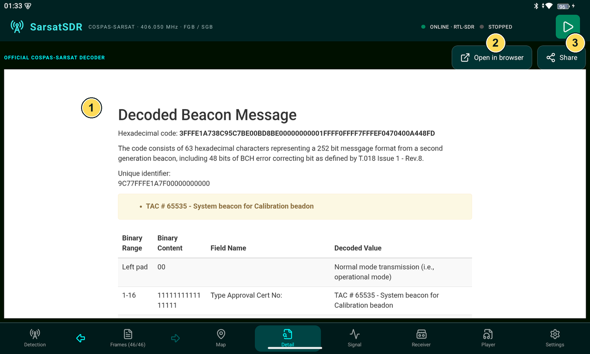</a></td>
<td valign="top">
<ol>
<li><strong>External decoder page.</strong> Receives the selected frame's corrected hexadecimal data and displays its interpretation. Scroll inside the page to read more. Its appearance and availability depend on the external service.</li>
<li><strong>Open in browser.</strong> Opens the same message URL in the device's browser.</li>
<li><strong>Share.</strong> Offers Copy Data, Copy URL, Share Data, and Share URL. Data means the corrected hexadecimal frame; URL means its external decoder link.</li>
</ol>
</td>
</tr>
</table>

**Privacy and connectivity:** opening this tab sends the selected message's
corrected hexadecimal data to `decoder2.herokuapp.com`. It requires Internet
access. Stay in Frames to inspect locally decoded information without using
that service.

Select another frame with the bottom arrows or in Frames to change the message.
An external website failing to load does not mean local decoding failed.

## 📈 Signal

Signal is the engineering view for the selected message, useful when checking
modulation, synchronization, or suspect bits.

<table>
<tr>
<td width="60%" valign="top"><a href="images/signal-sgb-guide.png">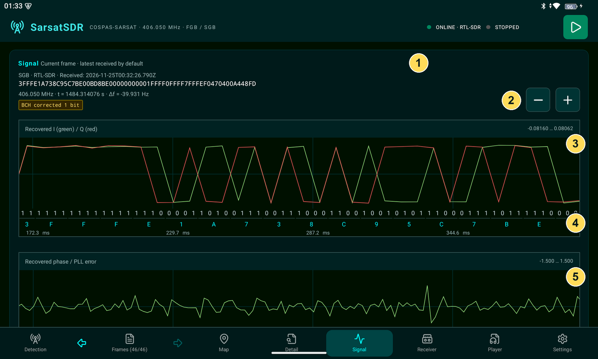</a></td>
<td valign="top">
<ol>
<li><strong>Selected-message summary.</strong> Shows generation, source, received time, hexadecimal data, frequency, source time, frequency offset, and BCH status.</li>
<li><strong>Zoom controls.</strong> Use - / + to zoom out/in, or pinch a trace. The initial view starts at the beginning of the frame.</li>
<li><strong>Recovered SGB I/Q.</strong> I is green and Q is red. Both components share the same horizontal time window. This plot is specific to SGB.</li>
<li><strong>Bits, hexadecimal data, and time scale.</strong> At sufficient zoom, inspect raw bits and their hexadecimal grouping. Drag horizontally to move along the message.</li>
<li><strong>Recovered phase / PLL error.</strong> Shows the tracked phase. For FGB this is the main trace, with the bit display beneath it; for SGB it sits below the I/Q plot.</li>
</ol>
</td>
</tr>
</table>

Scroll down if a lower plot extends beyond the screen. SGB plots remain aligned
while zooming and panning. A message without retained engineering trace data
can show its summary without a graph.

## 📻 Receiver

Receiver controls tuning, generation/mode selection, and spectrum presentation.
Its main controls fit beside the spectrum; scroll the page down for diagnostics.

<table>
<tr>
<td width="60%" valign="top"><a href="images/receiver-guide.png">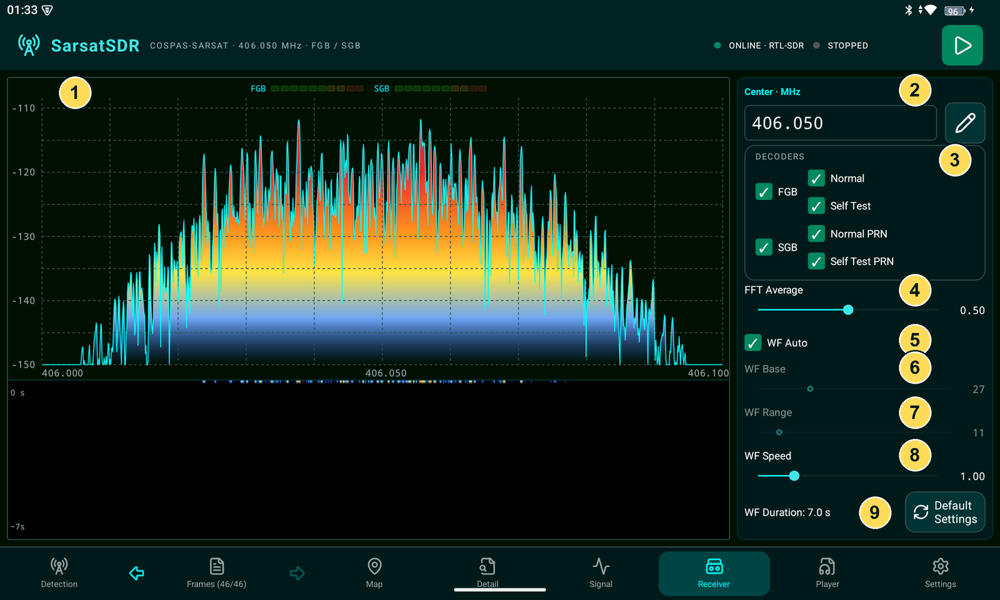</a></td>
<td valign="top">
<ol>
<li><strong>Spectrum and waterfall.</strong> Monitor the band while adjusting display settings. These controls affect presentation, not BCH correction capacity.</li>
<li><strong>Center frequency.</strong> Tap the MHz input directly or use the pencil to focus it. Enter 100 to 999 MHz and finish editing to apply. Retuning during live reception restarts acquisition cleanly; stored frames keep their original frequency.</li>
<li><strong>Decoders.</strong> Enable FGB and/or SGB, then their Normal/Self Test options. SGB uses separate Normal PRN/Self Test PRN choices. Mode controls dim when their generation is disabled. Leaving both modes unchecked also disables that generation's detection.</li>
<li><strong>FFT Average.</strong> Adjusts spectrum averaging. Peak attack and the slow decay remain display behavior, not additional received bursts.</li>
<li><strong>WF Auto.</strong> Automatically estimates the noise background and adjusts waterfall contrast. Enabled by default; Base and Range are then unavailable.</li>
<li><strong>WF Base.</strong> Manual background-level adjustment. Increasing it darkens the background.</li>
<li><strong>WF Range.</strong> Manual contrast adjustment. Increasing it reduces contrast.</li>
<li><strong>WF Speed.</strong> Sets scrolling from 0.25x to 4x. WF Duration below shows the resulting visible history: 28 to 1.75 seconds, with 7 seconds at the default 1x.</li>
<li><strong>Default Settings.</strong> Opens a confirmation before resetting receiver frequency, generation/mode selections, and display controls. It does not reset the separate advanced RTL-SDR settings.</li>
</ol>
</td>
</tr>
</table>

Decoder settings are locked while a session is active. During playback with a
validated profile, the displayed decoder configuration comes from that profile.
Both generations may be disabled if you only want the spectrum and waterfall.

### 🩺 Receiver diagnostics

Swipe upward on the Receiver page to reveal the status and acquisition panels.

<table>
<tr>
<td width="60%" valign="top"><a href="images/receiver-metrics-guide.png">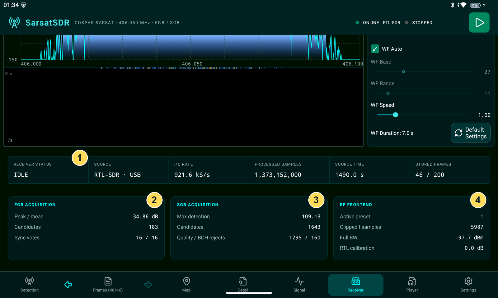</a></td>
<td valign="top">
<ol>
<li><strong>Session readouts.</strong> Status, source, I/Q rate, processed sample count, source time, and stored-frame count summarize the active or most recent session.</li>
<li><strong>FGB acquisition.</strong> Peak/mean level, candidate count, and synchronization votes help distinguish signal detection from successful frame decoding.</li>
<li><strong>SGB acquisition.</strong> Maximum detection level, candidate count, and quality/BCH rejection counts show where candidates are being rejected.</li>
<li><strong>RF frontend.</strong> Active gain preset, clipped I samples, Full BW power estimate, and calibration help diagnose reception conditions. The active preset may differ from the initial preset when AGC is enabled.</li>
</ol>
</td>
</tr>
</table>

Counters describe the session; they are not a count of valid distress messages.
Clipped samples can indicate excessive input level. Full BW is an estimated
integrated receiver-band power in RTL mode, not the height of a spectrum peak.
WAV levels are relative and do not provide this RF power measurement.

## ⏯️ Player

Player replays captures at their original pace. During live RTL-SDR reception,
the same screen provides recording controls.

### ▶️ Play a WAV

<table>
<tr>
<td width="60%" valign="top"><a href="images/player-guide.png">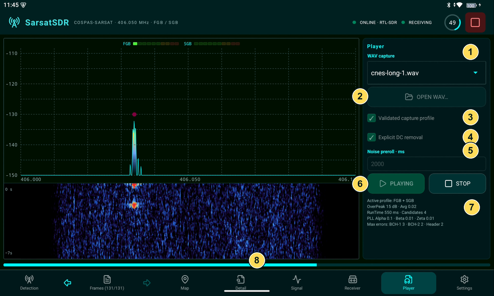</a></td>
<td valign="top">
<ol>
<li><strong>WAV capture.</strong> Select one of the bundled files. Stop the active session before changing sources.</li>
<li><strong>OPEN WAV.</strong> On Android, choose a compatible file through the system picker. A recording made by the app carries its center frequency for playback.</li>
<li><strong>Validated capture profile.</strong> Uses the tested decoder, DC-removal, and preroll settings for a known capture, without overwriting live radio settings. If no profile exists, use manual mode.</li>
<li><strong>Explicit DC removal.</strong> Removes the mean I/Q offset before decoding. It is editable in manual mode; a validated profile determines it otherwise.</li>
<li><strong>Noise preroll.</strong> Prepares decoder state before processing the capture. The engine repeats an initial portion of the WAV; reported frame times exclude this prefix. A profile controls the configured value when enabled. During playback this field counts down the remaining preroll milliseconds from the engine's processed samples, then stays at zero. The configured value returns when playback stops.</li>
<li><strong>PLAY / STOP.</strong> PLAY starts playback and becomes PREROLL while the prefix is processed, then PLAYING when the capture begins. Without a preroll it becomes PLAYING directly. STOP ends either phase; there is no pause or seek control.</li>
<li><strong>Active profile summary.</strong> Shows which generations and relevant FGB parameters the selected profile will use. Manual mode instead uses the decoder settings from Settings.</li>
<li><strong>Progress bar.</strong> Shows progress through the capture. It is an indicator, not a seek slider.</li>
</ol>
</td>
</tr>
</table>

Supported files contain **stereo I/Q**, not ordinary microphone audio:
8-bit PCM, 16-bit PCM, or 32-bit floating-point WAV. Large files are loaded
into memory, so available device RAM matters.

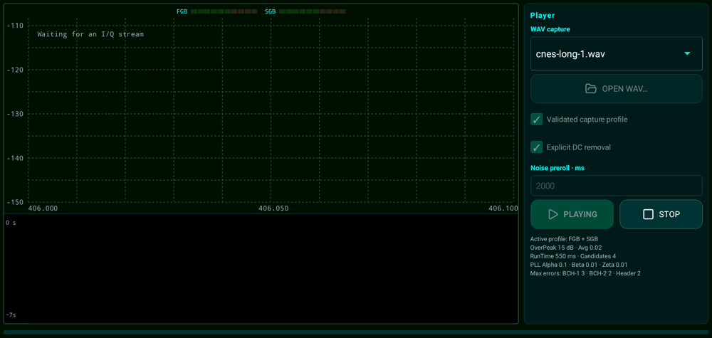

You can switch to Detection, Frames, Map, Detail, or Signal during playback.
Received messages remain in the history after playback finishes.

### ⏺️ Record live I/Q

<table>
<tr>
<td width="60%" valign="top"><a href="images/player-record-guide.png">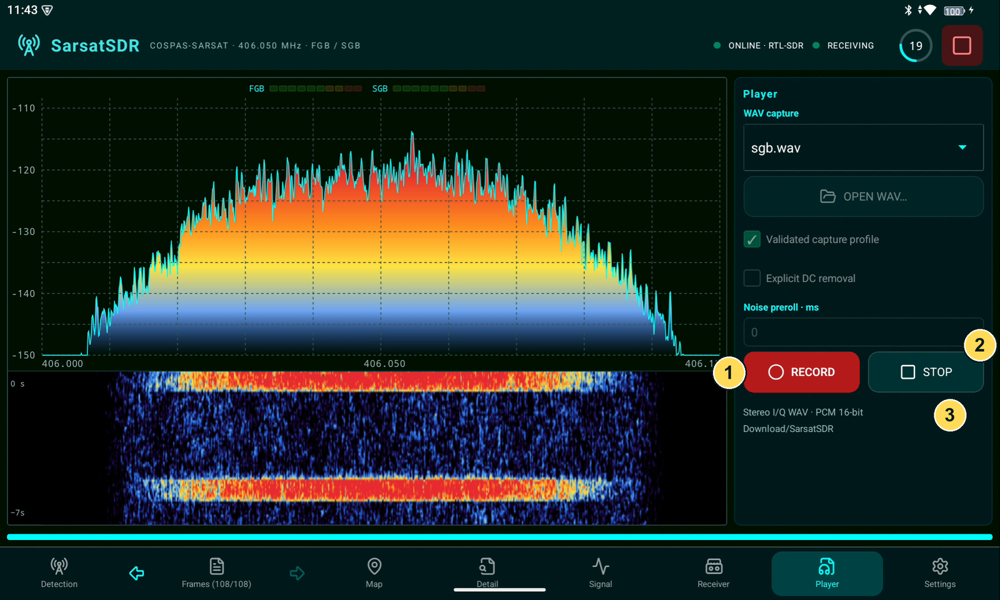</a></td>
<td valign="top">
<ol>
<li><strong>RECORD.</strong> Available during live RTL-SDR reception on supported Android devices. Tap to begin saving I/Q; the button becomes RECORDING and the bottom bar turns red with a continuous scrolling animation.</li>
<li><strong>STOP.</strong> While recording, the first press finalizes the WAV without stopping reception. Once recording has stopped, pressing STOP ends reception.</li>
<li><strong>Recording information.</strong> Shows the destination, current capture, or most recently saved file. Source selection and playback controls remain unavailable during live reception.</li>
</ol>
</td>
</tr>
</table>

- Recording requires **Android 10 or later** and writes stereo **16-bit PCM I/Q**
  at **921600 complex samples/s**.
- Files appear under **Download/SarsatSDR**, named
  `capture-DD-MM-YYYY_HH-mm-ss.wav`.
- Stopping the receiver, retuning, or reconnecting also finalizes the current
  recording. Use **OPEN WAV** later to replay a saved file.
- RIFF/WAV size is limited to **4 GiB**, approximately **19 minutes**.
  Keep sufficient free storage. A write failure is reported and an incomplete
  capture is not published as a successful recording.
- Native I/Q recording is not available in the Windows browser interface.

## ⚙️ Settings

Scroll vertically to reach the three main groups: **Filtering**, **Audio**,
and **RTL-SDR**. Each has its own confirmed reset action. Settings are saved
locally and restored on the next launch, except for USB device selection.
When editing a number, the app keeps the input above the on-screen keyboard.

### ℹ️ Version

The single-line **Version** strip at the top of Settings, before Filtering,
shows the installed application version. Include it when reporting a problem
or comparing builds.

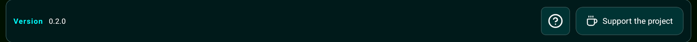

### 🔊 Filtering and audio

<table>
<tr>
<td width="60%" valign="top"><a href="images/settings-audio-guide.png">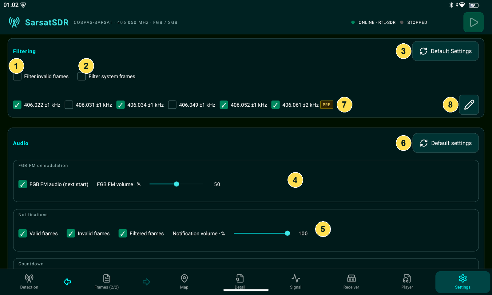</a></td>
<td valign="top">
<ol>
<li><strong>Filter invalid frames.</strong> Hides frames with failed BCH checks or applicable correction-limit failures. The stored messages remain available when the filter is disabled and are still exported.</li>
<li><strong>Filter system frames.</strong> Hides FGB ORB and SGB SYSTM messages. Turn it off when exploring bundled system-beacon examples.</li>
<li><strong>Filtering defaults.</strong> Restores both display filters to enabled after confirmation.</li>
<li><strong>FGB FM demodulation.</strong> Enables audio for the next acquisition/playback start. The independent FM volume defaults to 50%. Hearing FM does not imply successful synchronization or BCH decoding.</li>
<li><strong>Notifications.</strong> Enables distinct frame sounds and sets their volume. Different sounds indicate accepted, invalid, and filtered messages. The notification volume also controls countdown beeps.</li>
<li><strong>Audio defaults.</strong> Resets FM audio, notifications, and countdown preferences together after confirmation, without resetting filters or RF settings.</li>
</ol>
</td>
</tr>
</table>

Both filters are **enabled by default**; they are deliberately disabled in these
screenshots to show system/test traffic and invalid frames.
Filtering affects presentation, not RF acquisition. FGB FM audio is muted for
the first two seconds of live acquisition while the frontend settles.

### ⏱️ Countdown

<table>
<tr>
<td width="60%" valign="top"><a href="images/settings-countdown-guide.png">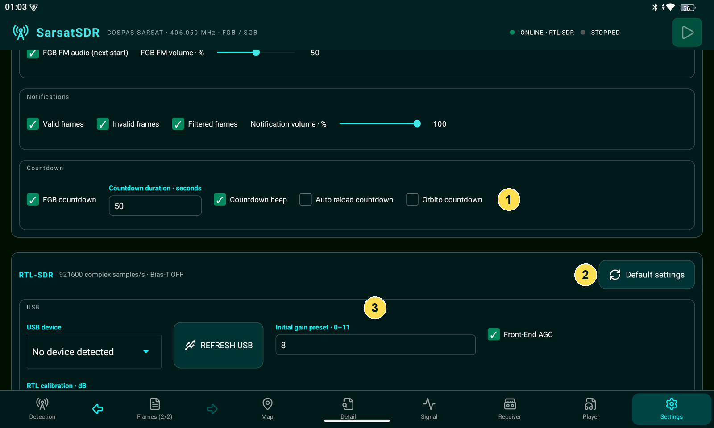</a></td>
<td valign="top">
<ol>
<li><strong>Countdown controls.</strong> Enable FGB countdown, set its duration in seconds, toggle the final beeps, and choose whether it automatically reloads after expiry.</li>
<li><strong>RTL-SDR defaults.</strong> This separate reset restores USB gain/AGC/calibration and advanced FGB/SGB parameters, after confirmation. It is not the Audio reset.</li>
<li><strong>Fixed acquisition configuration.</strong> RTL-SDR reception uses 921600 complex samples/s with Bias-T off. Scroll down for USB and decoder parameters.</li>
</ol>
</td>
</tr>
</table>

Countdown duration accepts **1 to 3600 seconds**, default **50**.
Countdown and its beeps are enabled by default; auto-reload is off.
See the [timer behavior](#understand-the-fgb-timer) above for count-up mode and
long-press reset.

### 🔌 RTL-SDR: USB and gain

<table>
<tr>
<td width="60%" valign="top"><a href="images/settings-usb-guide.png">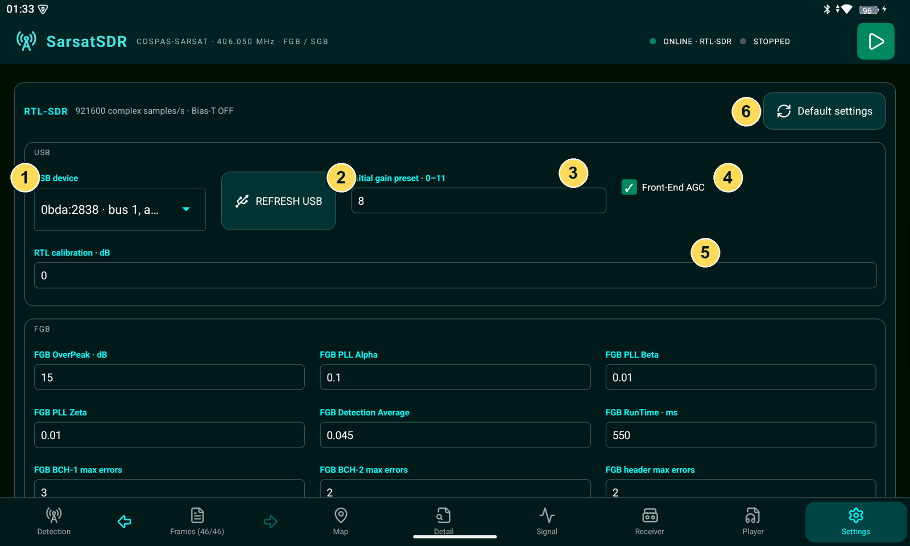</a></td>
<td valign="top">
<ol>
<li><strong>USB device.</strong> Select a detected receiver by USB ID, bus, and address. The list also refreshes on Android connect/disconnect events.</li>
<li><strong>REFRESH USB.</strong> Requests a fresh device list. If the receiver is absent, check the OTG connection and Android permission.</li>
<li><strong>Initial gain preset.</strong> Selects preset 0 through 11, default 8. This is a preset index, not a gain value in dB.</li>
<li><strong>Front-End AGC.</strong> Enables automatic frontend gain control. If enabled, the receiver may move away from the initial preset. Default: on.</li>
<li><strong>RTL calibration.</strong> Adds a display correction in dB, default 0. It affects spectrum, candidate levels, and Full BW readouts, not decoder sensitivity or input samples.</li>
<li><strong>RTL-SDR defaults.</strong> Resets this group's gain, AGC, calibration, and advanced decoder settings. Stop acquisition before changing hardware and decoder parameters.</li>
</ol>
</td>
</tr>
</table>

To calibrate the RF display, use a known source and enter its known level minus
the displayed level. Without a reference measurement, treat dBm values as
estimates. Raising calibration does not improve the received signal.

### 📡 RTL-SDR: FGB

<table>
<tr>
<td width="60%" valign="top"><a href="images/settings-fgb-guide.png">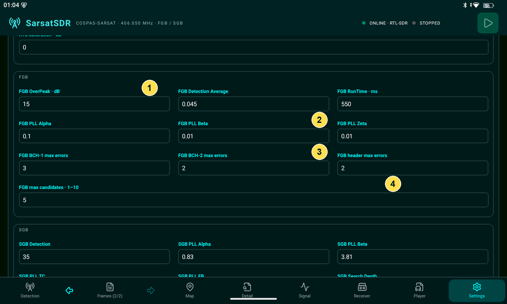</a></td>
<td valign="top">
<ol>
<li><strong>Detection and candidate lifetime (first row).</strong> OverPeak sets the detection peak-above-average threshold; Detection Average controls detection averaging; RunTime is the processing lifetime of a candidate in milliseconds.</li>
<li><strong>PLL tracking (second row).</strong> Alpha and Beta control phase/frequency tracking during initial acquisition. Zeta controls subsequent phase tracking.</li>
<li><strong>Error limits.</strong> BCH-1, BCH-2, and header limits control accepted corrections/mismatches. They do not increase the BCH code's mathematical correction capacity.</li>
<li><strong>Max candidates.</strong> Limits simultaneous FGB candidates from 1 to 10, default 4. It applies to reception and playback, including validated profiles. Reducing it can leave fewer slots available in a busy band.</li>
</ol>
</td>
</tr>
</table>

| FGB setting | Default |
|---|---|
| OverPeak | 15 dB |
| PLL Alpha / Beta / Zeta | 0.1 / 0.01 / 0.01 |
| Detection Average | 0.045 |
| RunTime | 550 ms |
| BCH-1 / BCH-2 / header max errors | 3 / 2 / 2 |
| Max candidates | 4 |

These are advanced controls. Start with defaults and compare the same recording
when testing a change. Raising allowed errors is not a substitute for a clean
signal.

### 🛰️ RTL-SDR: SGB

<table>
<tr>
<td width="60%" valign="top"><a href="images/settings-sgb-guide.png">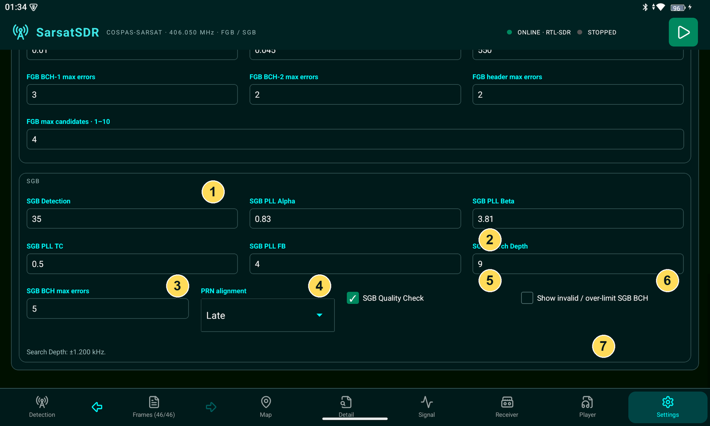</a></td>
<td valign="top">
<ol>
<li><strong>Detection and initial PLL controls.</strong> Detection sets the acquisition threshold. PLL Alpha and Beta control phase/frequency tracking.</li>
<li><strong>PLL TC, PLL FB, and Search Depth.</strong> Adjust tracking filter/feedback behavior and the searched frequency-offset range. These are decoder parameters, not waterfall controls.</li>
<li><strong>BCH max errors.</strong> Sets the permitted correction count, default 5. The SGB BCH code can correct up to six bits, but this acceptance limit may be lower.</li>
<li><strong>PRN alignment.</strong> Selects Early, Norm, or Late alignment, default Late. It is separate from the Normal PRN/Self Test PRN checkboxes in Receiver.</li>
<li><strong>SGB Quality Check.</strong> Enables the candidate quality check before accepting a decode. Enabled by default.</li>
<li><strong>Show invalid / over-limit SGB BCH.</strong> Allows otherwise rejected BCH failures or over-limit results to reach the interface for inspection. Filter invalid frames may still hide them.</li>
<li><strong>Search range readout.</strong> Displays the frequency span corresponding to Search Depth. The default 9 corresponds to approximately +/-1.200 kHz.</li>
</ol>
</td>
</tr>
</table>

| SGB setting | Default |
|---|---|
| Detection | 35 |
| PLL Alpha / Beta | 0.83 / 3.81 |
| PLL TC / FB | 0.5 / 4 |
| Search Depth | 9 |
| BCH max errors | 5 |
| PRN alignment | Late |
| Quality Check | Enabled |
| Show invalid / over-limit SGB BCH | Disabled |

## ↩️ Restoring defaults

Receiver, Filtering, Audio, and RTL-SDR have separate reset buttons.
Always check the group named in the dialog before confirming.

<table>
<tr>
<td width="60%" valign="top"><a href="images/restore-defaults-guide.png">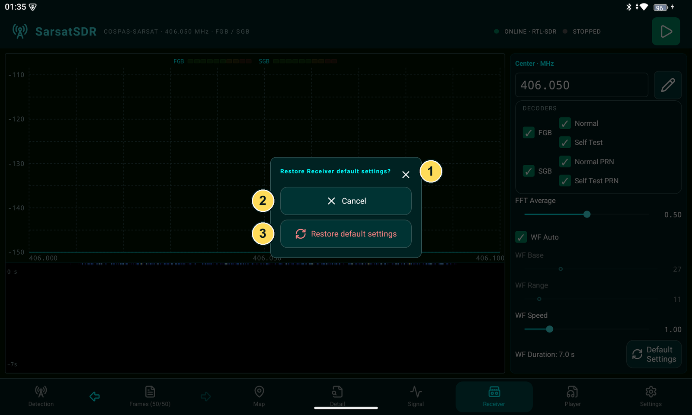</a></td>
<td valign="top">
<ol>
<li><strong>Dialog title and close button.</strong> Identifies the group about to be reset. Close dismisses the dialog without changing settings.</li>
<li><strong>Cancel.</strong> Keeps the current settings.</li>
<li><strong>Restore default settings.</strong> The red action applies defaults to the named group. It does not clear stored frames; clearing history has its own confirmation.</li>
</ol>
</td>
</tr>
</table>

## 🩺 Troubleshooting

| Observation | What to check |
|---|---|
| No receiver listed | USB host/OTG support, cable, Android permission, and REFRESH USB. On Windows, check the WinUSB driver as described in the developer guide. |
| A signal is visible but no message appears | Correct center frequency; enabled FGB/SGB modes; system/invalid display filters; candidate and rejection diagnostics. A visible carrier does not guarantee decodable modulation. |
| FGB audio is audible but BCH fails | Audio and decoding have different acceptance requirements. Inspect signal quality, gain, clipping, and BCH/header results. |
| Many failures in a noisy location | Inspect clipped samples and active gain. Try a lower fixed gain with Front-End AGC off; compare the same captured I/Q before changing advanced decoder parameters. |
| Bundled example produces no visible frames | Use its validated profile and check Filter system frames; several examples contain ORB or SYSTM traffic. |
| Message has no map position | The message may not encode a usable position. Check which frame supplied the currently displayed map coordinates. |
| Detail is blank or reports a network error | The external service needs Internet access. Use locally decoded fields in Frames meanwhile. |
| Playback controls are disabled | Stop the active live/playback session first. DC removal and preroll are controlled by the validated profile while it is enabled. |
| No FM audio | Check FGB FM audio, its independent volume, and the next-start requirement. The initial live mute lasts two seconds; audio also requires a suitable acquired FGB carrier. |
| Recording is unavailable or stops | Use the Android app on Android 10+, start live reception, check free storage, and observe the 4 GiB file limit. |

For command-line decoding, C API integration, builds, and regression tests, see
the [developer guide](../DEVELOPER_README.md).
