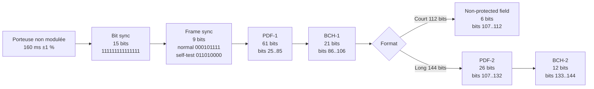

# spec-fgb.md — Spécification signal FGB 406 MHz, C/S T.001 Issue 4 Rev.7, mars 2021

> Source : `spec-fgb-T001-MAR-26-2021 SPECIFICATION FOR COSPAS-SARSAT 406 MHz DISTRESS BEACONS.pdf`, **C/S T.001 — Specification for Cospas-Sarsat 406 MHz Distress Beacons**, Issue 4 Rev.7, March 2021.  
> Objectif de ce mémo : extraire les paramètres utiles à une acquisition/démodulation/décodage SDR ou récepteur des balises 406 MHz de **première génération**.

## 1. Modulation exacte et convention de signe

- **Modulation RF** : modulation de phase de la porteuse, avec données encodées en **biphase-L**.
- **Excursion de phase** : la porteuse est modulée en phase à **+1.1 ± 0.1 rad** et **−1.1 ± 0.1 rad** crête, référencée à la porteuse non modulée.
- **Convention de signe explicitement donnée** :
  - un **déphasage positif** est une **avance de phase** par rapport à la phase nominale de la porteuse non modulée ;
  - le sens précis de modulation biphase-L est celui de la **Figure 2.5 — Data Encoding and Modulation Sense** du document.
- **Pas d’OQPSK / pas de DSSS** pour les balises FGB : contrairement aux SGB, il n’y a pas de voies I/Q étalées par PRN.
- **Pas de convention I/Q normative** dans T.001 : le signal est spécifié comme une modulation de phase RF de porteuse, pas comme une modulation quadrature complexe.

### Implication baseband pratique

Un récepteur SDR peut représenter le signal en complexe après mélange en bande de base, mais la spécification FGB ne définit pas d’axe I/Q de référence. Les ambiguïtés usuelles de réception restent donc à absorber : phase constante, inversion de signe, conjugaison, choix `I+jQ` / `I−jQ`, CFO résiduel.

## 2. Débit symbole/chip, mapping bit → symboles/chips

### Débit binaire

- **Débit binaire nominal** : **400 bit/s ± 1 %**.
- Cas particuliers : pour les **ELT(DT)** et les balises à protocole de localisation **RLS**, le message long de 144 bits est transmis à **400 bit/s ± 0.1 %**.
- **Durée bit nominale** : `Tb = 1 / 400 = 2.5 ms`.

### Mapping bit → biphase-L

- Les données sont encodées en **biphase-L**.
- Un bit biphase-L occupe une période bit complète de **2.5 ms** et contient une transition au milieu du bit, donc deux demi-bits de **1.25 ms**.
- La spécification renvoie au sens exact de la **Figure 2.5** pour l’association bit logique / polarité de phase.
- La modulation de phase résultante alterne entre les deux états de phase :

```text
phase positive : +1.1 rad nominal, avance de phase
phase négative : -1.1 rad nominal, retard de phase
```

### Chips

- Il n’y a **pas de chips DSSS** dans la génération FGB.
- Si l’on veut parler en “symboles” de modulation, un bit biphase-L peut être vu comme **2 demi-symboles de phase**.
- Débit demi-symbole associé : **800 demi-symboles/s**.

## 3. Préambule et mot(s) de synchro

Le début du burst FGB est constitué d’une porteuse non modulée, puis d’une partie modulée contenant synchronisation bit, synchronisation trame et données.

### Porteuse non modulée

- **Durée** : **160 ms ± 1 %**.
- Cette porteuse est transmise avant le début de la modulation et sert à l’acquisition porteuse / fréquence.

### Synchronisation bit

- **Longueur** : **15 bits**.
- **Positions** : bits **1 à 15**.
- **Pattern** : quinze `1` consécutifs :

```text
111111111111111
```

### Synchronisation trame

- **Longueur** : **9 bits**.
- **Positions** : bits **16 à 24**.
- **Pattern normal opérationnel** :

```text
000101111
```

- **Pattern self-test** :

```text
011010000
```

Ce pattern self-test correspond au complément des 8 derniers bits du pattern normal et permet d’éviter le traitement opérationnel par les équipements satellite.

### Format flag

- **Position** : bit **25**.
- **Valeurs** :

```text
0 = message court, 112 bits
1 = message long, 144 bits
```

## 4. Structuration de trame

## 4 bis. Schéma de la structure de trame

### Vue temporelle du burst complet

```text
Message court FGB
Durée totale : 440 ms ±1 %

┌──────────────────────────────┬──────────────────────────────────────────────┐
│ Porteuse non modulée          │ Message modulé biphase-L                    │
│ 160 ms ±1 %                   │ 280 ms ±1 %                                  │
│ acquisition fréquence/phase   │ 112 bits à 400 bit/s                         │
└──────────────────────────────┴──────────────────────────────────────────────┘
```

```text
Message long FGB
Durée totale : 520 ms ±1 %

┌──────────────────────────────┬──────────────────────────────────────────────┐
│ Porteuse non modulée          │ Message modulé biphase-L                    │
│ 160 ms ±1 %                   │ 360 ms ±1 %                                  │
│ acquisition fréquence/phase   │ 144 bits à 400 bit/s                         │
└──────────────────────────────┴──────────────────────────────────────────────┘
```

### Vue binaire commune : bits système

```text
bits 1..24 = synchronisation système

bit:   1              15 16       24 25
       │               │ │         │ │
       ▼               ▼ ▼         ▼ ▼
       ┌────────────────┬───────────┬─────────────
       │ Bit sync        │ Frame sync│ Format flag ...
       │ 15 bits         │ 9 bits    │ bit 25
       │ 111...111       │ normal : 000101111
       │                 │ test   : 011010000
       └────────────────┴───────────┴─────────────
```

### Message court : 112 bits

```text
bit:   1        15 16     24 25                         85 86       106 107   112
       │         │ │       │ │                           │ │          │ │       │
       ▼         ▼ ▼       ▼ ▼                           ▼ ▼          ▼ ▼       ▼
       ┌──────────┬─────────┬─────────────────────────────┬────────────┬─────────┐
       │ Bit sync │ Frame   │ PDF-1                       │ BCH-1      │ Non-   │
       │ 15 bits  │ sync    │ 61 bits                     │ 21 bits    │ protected
       │          │ 9 bits  │ bits 25..85                 │ bits 86..106│ 6 bits │
       └──────────┴─────────┴─────────────────────────────┴────────────┴─────────┘
```

### Message long : 144 bits

```text
bit:   1        15 16     24 25                         85 86       106 107      132 133     144
       │         │ │       │ │                           │ │          │ │          │ │         │
       ▼         ▼ ▼       ▼ ▼                           ▼ ▼          ▼ ▼          ▼ ▼         ▼
       ┌──────────┬─────────┬─────────────────────────────┬────────────┬─────────────┬──────────┐
       │ Bit sync │ Frame   │ PDF-1                       │ BCH-1      │ PDF-2       │ BCH-2    │
       │ 15 bits  │ sync    │ 61 bits                     │ 21 bits    │ 26 bits     │ 12 bits  │
       │          │ 9 bits  │ bits 25..85                 │ bits 86..106│ bits107..132│ bits133..144
       └──────────┴─────────┴─────────────────────────────┴────────────┴─────────────┴──────────┘
```

### Détail de PDF-1 commun aux formats court/long

```text
PDF-1 : bits 25..85, 61 bits

25 26 27         36 37                           85
│  │  │           │ │                             │
▼  ▼  ▼           ▼ ▼                             ▼
┌──┬──┬────────────┬───────────────────────────────┐
│F │P │ Country    │ Protocol + identification /   │
│1 │1 │ code       │ position selon protocole      │
│  │  │ 10 bits    │ bits 37..85, 49 bits          │
└──┴──┴────────────┴───────────────────────────────┘
F = format flag, P = protocol flag
```

### Vue Mermaid optionnelle



## 5. Structure détaillée des messages

### Message court, 112 bits

- Bits **1–24** : bits système de synchronisation.
- Bits **25–85** : **PDF-1**, premier champ de données protégé, **61 bits**.
- Bits **86–106** : **BCH-1**, **21 bits**.
- Bits **107–112** : champ non protégé, **6 bits**, utilisé notamment pour emergency code / national use selon protocole.

### Message long, 144 bits

- Bits **1–24** : bits système de synchronisation.
- Bits **25–85** : **PDF-1**, **61 bits**.
- Bits **86–106** : **BCH-1**, **21 bits**.
- Bits **107–132** : **PDF-2**, second champ de données protégé, **26 bits**.
- Bits **133–144** : **BCH-2**, **12 bits**.

### Flags et codes communs dans PDF-1

- Bit **25** : format flag `F`.
  - `0` = short format.
  - `1` = long format.
- Bit **26** : protocol flag `P`.
  - `0` = standard location, national location, RLS location ou ELT(DT) location protocols.
  - `1` = user protocols ou user-location protocols.
- Bits **27–36** : country code sur 10 bits.
- Bits **37–39** ou **37–40** : protocol code selon la famille de protocole.

### 15 Hex ID

- Le **15 Hex ID** unique de la balise est constitué par les bits **26 à 85** de PDF-1.
- Pour les protocoles de localisation, les bits de position dans PDF-1 sont mis aux valeurs par défaut lors de la construction de l’identification.

### Scrambling / interleaving

- La spécification ne décrit **pas de scrambling additionnel**.
- La spécification ne décrit **pas d’interleaving**.
- La robustesse binaire est assurée par les deux codes BCH, selon le format.

## 6. Codage canal et ordre d’application

### BCH-1 pour PDF-1

- Champ protégé : bits **25–106** = PDF-1 + BCH-1.
- Code : **BCH(82,61)**.
- Origine : forme raccourcie d’un **BCH(127,106)**.
- Données : **61 bits**.
- Parité/correction : **21 bits**.
- Capacité : correction jusqu’à **3 erreurs** dans les 82 bits de PDF-1 + BCH-1.
- Pour le calcul, **45 zéros** sont préfixés aux 61 bits de données afin de travailler sur le code complet BCH(127,106). Ces zéros ne sont pas transmis.

Générateur BCH-1 :

```text
g1(x) = x^21 + x^18 + x^17 + x^15 + x^14 + x^12 + x^11
      + x^8 + x^7 + x^6 + x^5 + x + 1
```

Représentation binaire 22 bits :

```text
1001101101100111100011
```

### BCH-2 pour PDF-2, message long uniquement

- Champ protégé : bits **107–144** = PDF-2 + BCH-2.
- Code : **BCH(38,26)**.
- Origine : forme raccourcie d’un **BCH(63,51)**.
- Données : **26 bits**.
- Parité/correction : **12 bits**.
- Capacité : correction jusqu’à **2 erreurs** dans les 38 bits de PDF-2 + BCH-2.
- Pour le calcul, **25 zéros** sont préfixés aux 26 bits de données afin de travailler avec le code complet.

Générateur BCH-2 :

```text
g2(x) = (1 + x + x^6) · (1 + x + x^2 + x^4 + x^6)
      = 1 + x^3 + x^4 + x^5 + x^8 + x^10 + x^12
```

Représentation binaire 13 bits utilisée dans l’exemple de division :

```text
1010100111001
```

### Ordre d’application émetteur

1. Construire PDF-1, bits 25–85.
2. Calculer BCH-1 sur PDF-1, puis remplir bits 86–106.
3. Si message long : construire PDF-2, bits 107–132.
4. Si message long : calculer BCH-2 sur PDF-2, puis remplir bits 133–144.
5. Ajouter les bits système transmis en tête : bit sync 15 bits + frame sync 9 bits.
6. Encoder tout le message binaire en biphase-L.
7. Moduler la porteuse en phase ±1.1 rad.
8. Émettre après une porteuse non modulée de 160 ms.

## 7. Fréquence intermédiaire attendue après acquisition

La spécification fixe les exigences RF émetteur, pas une fréquence intermédiaire récepteur imposée.

### Fréquence RF

- Bande Cospas-Sarsat : **406.0 à 406.1 MHz**.
- Les canaux sont définis par leur fréquence centrale assignée par Cospas-Sarsat.
- Sauf cas historiques, la porteuse doit être réglée à :

```text
fréquence centrale du canal assigné + 1 kHz
```

- Canaux historiques :
  - canal **406.025 MHz** : porteuse réglée à **406.025 MHz + 2 kHz** ;
  - canal **406.028 MHz** : porteuse réglée à **406.028 MHz + 1 kHz**.

### Tolérances porteuse

- Cas général : variation maximale **+5 kHz** par rapport à la fréquence centrale du canal sur 5 ans.
- Canal 406.025 MHz : variation maximale **+5 kHz** par rapport à 406.025 MHz sur 5 ans.
- Canal 406.028 MHz : variation maximale **+2 kHz / −5 kHz** par rapport à 406.028 MHz sur 5 ans.
- Variation court terme : **≤ 2 × 10⁻⁹** sur **100 ms**.
- Stabilité moyen terme, hors ELT(DT) :
  - pente moyenne fréquence/temps sur 15 min : **≤ 1 × 10⁻⁹ par minute** ;
  - variation résiduelle RMS : **≤ 3 × 10⁻⁹**.
- Conditions de gradient thermique / choc thermique : pente moyenne **≤ 2 × 10⁻⁹ par minute**, variation résiduelle RMS **≤ 3 × 10⁻⁹**.
- Pour les **ELT(DT)**, l’exigence de stabilité moyen terme ne s’applique pas.

### Implication récepteur

Après mélange sur la fréquence cible, le signal peut être placé autour de DC. La fenêtre d’acquisition CFO doit couvrir :

- l’offset de canal nominal, incluant le `+1 kHz` ou `+2 kHz` selon canal ;
- la tolérance balise jusqu’à plusieurs kHz selon canal ;
- l’erreur d’oscillateur récepteur ;
- les décalages Doppler et dynamiques éventuels.

## 8. Bande occupée et filtrage recommandé

### Masque d’émissions parasites

La spécification impose un masque d’émissions dans la bande **406.0–406.1 MHz**, mesuré avec une RBW de **100 Hz**. Les points du masque de la Figure 2.4 sont structurés autour de la porteuse `fc`.

Repères utiles du masque :

```text
fc ± 3 kHz   : environ -20 dBc
fc ± 7 kHz   : environ -30 dBc
fc ± 12 kHz  : environ -35 dBc
fc ± 24 kHz  : environ -40 dBc
```

La spécification ne donne pas un type de filtre unique côté émetteur dans le texte extrait. Elle impose le respect du masque et des paramètres de modulation temporelle.

### Paramètres temporels de modulation liés au filtrage

- Temps de montée et de descente du signal modulé : **150 +100 µs** dans la spécification imprimée.
- Pour **ELT(DT)** : temps de montée/descente entre **50 µs et 150 µs**.
- Symétrie de modulation :

```text
|τ1 − τ2| / (τ1 + τ2) ≤ 0.05
```

## 9. Contraintes de timing

### Durées de burst

- Message court : **440 ms ±1 %**.
  - 160 ms porteuse non modulée.
  - 280 ms message modulé, 112 bits à 400 bit/s.
- Message long : **520 ms ±1 %**.
  - 160 ms porteuse non modulée.
  - 360 ms message modulé, 144 bits à 400 bit/s.

### Répétition des bursts, balises hors ELT(DT)

- La période de répétition est randomisée autour d’une moyenne de **50 s**.
- Les intervalles entre transmissions sont uniformément distribués entre :

```text
47.5 s et 52.5 s
```

### ELT(DT)

Sauf cas particulier des ELT(DT) transmettant le 3LD en PDF-2 :

- de 0 à 120 s après activation : période **5 s +0.0 / −0.2 s** ;
- de 120 à 300 s : période **10 s +0.0 / −0.2 s** ;
- après 300 s : période randomisée autour de **28.5 s**, intervalle **27.0 à 30.0 s**.

### Activation

- Après activation, une balise non ELT(DT) ne doit pas transmettre un message de détresse 406 MHz avant qu’au moins une période de répétition ait expiré.
- Un ELT automatiquement activé par G-switch/déformation doit transmettre dès que possible, au plus tard **15 s** après activation.
- Un ELT(DT) doit commencer à transmettre dans les **5 s** après activation.

### Annulation ELT(DT)

- Premier message d’annulation dans les **5 s** après désactivation.
- Total : **10 messages identiques**.
- Intervalle : **10 s ±0.5 s**.

### CFO / dérive / stabilité

- Court terme : **≤ 2 × 10⁻⁹ sur 100 ms**.
- Moyen terme hors ELT(DT) : pente **≤ 1 × 10⁻⁹/min**, RMS résiduel **≤ 3 × 10⁻⁹**.
- Gradient thermique / choc : pente **≤ 2 × 10⁻⁹/min**, RMS résiduel **≤ 3 × 10⁻⁹**.

### STO / timing bit

La spécification ne donne pas de tolérance STO côté récepteur. Les contraintes de signal pertinentes sont :

- bit rate **400 bit/s ±1 %**, ou **±0.1 %** pour ELT(DT)/RLS long message ;
- synchronisation bit de 15 bits `1` ;
- frame sync 9 bits ;
- durée totale de burst ±1 % ;
- biphase-L avec transition intra-bit.

## 10. Référence d’axe I/Q, swap/conjugaison éventuels

### Ce qui est spécifié

- La spécification FGB définit une **porteuse RF modulée en phase**, pas un modulateur I/Q.
- Elle ne définit donc pas :
  - d’axe I ;
  - d’axe Q ;
  - de retard I/Q ;
  - de convention `I+jQ` / `I−jQ` ;
  - de règle de swap I/Q.

### Conséquence pratique

Pour des échantillons complexes SDR, prévoir de tester ou compenser :

- rotation de phase constante ;
- conjugaison complexe ;
- inversion de signe de la phase démodulée ;
- CFO résiduel ;
- alignement temporel sur la porteuse non modulée, puis bit sync/frame sync.

La validation peut utiliser :

1. détection de la porteuse non modulée de 160 ms ;
2. récupération du biphase-L à 400 bit/s ;
3. détection de la séquence bit sync `111111111111111` ;
4. détection du frame sync normal `000101111` ou self-test `011010000` ;
5. vérification BCH-1 et, si message long, BCH-2.

## 11. Résumé opérationnel pour un démodulateur

```text
Signal             : porteuse 406 MHz modulée en phase
Modulation          : biphase-L + phase modulation ±1.1 rad
Phase positive      : avance de phase vs porteuse nominale
Débit               : 400 bit/s ±1 %
Débit ELT(DT)/RLS   : 400 bit/s ±0.1 % pour long message
Porteuse non mod.   : 160 ms ±1 %
Message court       : 112 bits, 280 ms, burst total 440 ms ±1 %
Message long        : 144 bits, 360 ms, burst total 520 ms ±1 %
Bit sync            : 15 bits = 111111111111111
Frame sync normal   : 000101111
Frame sync self-test: 011010000
Format flag         : bit 25, 0 court / 1 long
PDF-1               : bits 25..85, 61 bits
BCH-1               : bits 86..106, BCH(82,61), 21 bits, corrige 3 erreurs
PDF-2               : bits 107..132, 26 bits, message long uniquement
BCH-2               : bits 133..144, BCH(38,26), 12 bits, corrige 2 erreurs
Répétition hors DT  : aléatoire 47.5..52.5 s, moyenne 50 s
ELT(DT)             : 5 s, puis 10 s, puis 27..30 s
I/Q                 : non spécifié / non applicable au niveau normatif
Scrambling          : non spécifié
Interleaving        : non spécifié
```

## 12. Points non explicitement spécifiés dans le document

- Fréquence intermédiaire récepteur après acquisition.
- Convention complexe `I+jQ` / `I−jQ`.
- Scrambling additionnel.
- Interleaving.
- Type de filtre émetteur unique ; seuls masque spectral et paramètres temporels sont normatifs.
- Tolérance STO côté récepteur.
- Mapping biphase-L sous forme de table texte indépendante : le sens est porté par la Figure 2.5 du document.
