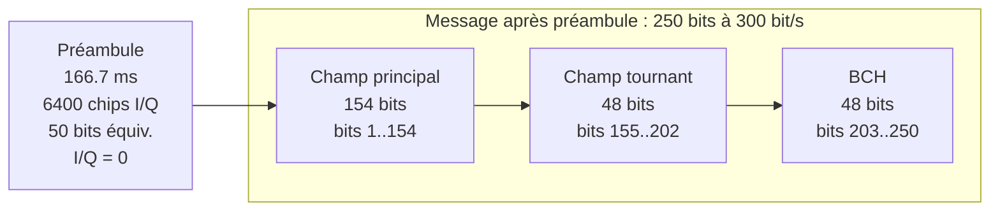

# spec-sgb.md — Spécification signal SGB 406 MHz, C/S T.018 Issue 1 Rev.7, mars 2021

> Source : `spec-sgb-T018-2021.pdf`, **C/S T.018 — Specification for Second-Generation Cospas-Sarsat 406-MHz Distress Beacons**, Issue 1 Rev.7, March 2021.  
> Objectif de ce mémo : extraire les paramètres utiles à une acquisition/démodulation/décodage SDR ou récepteur des balises 406 MHz de seconde génération.

## 1. Modulation exacte et convention de signe

- **Modulation RF** : **DSSS-OQPSK** — Direct Sequence Spread Spectrum avec **Offset Quadrature Phase Shift Keying**.
- **Composantes** :
  - les bits impairs du message alimentent la voie **I** ;
  - les bits pairs du message alimentent la voie **Q** ;
  - la voie **Q** est retardée de **1/2 période chip** par rapport à la voie **I** ;
  - donc **I mène Q de Tchip/2**.
- **Forme nottionnelle de modulation** : les composantes I et Q étalées sont modulées respectivement sur des sinusoïdes cosinus et sinus, puis sommées.
- **Convention logique → niveau signal** :
  - chip logique `0` → niveau **+1.0** ;
  - chip logique `1` → niveau **−1.0**.
- **Convention bit → PRN** :
  - bit message `0` → segment PRN **normal**, non inversé ;
  - bit message `1` → segment PRN **inversé**.
- **Conséquence pratique** : en représentation complexe baseband conforme au texte, on peut modéliser le signal comme une OQPSK où les niveaux ±1 issus des PRN I/Q sont appliqués sur I/Q, avec Q retardé de Tchip/2. La spécification ne donne pas explicitement une convention universelle de signe complexe du type `I + jQ` versus `I − jQ`; elle décrit cependant I sur cosinus, Q sur sinus, et I menant Q.
- **Qualité de modulation** :
  - décalage I/Q moyen : **Tchip/2 ± 1 % de Tchip** sur tout le burst ;
  - amplitudes crête-à-crête I et Q : écart moyen ≤ **15 %** ;
  - EVM des points de constellation : **< 15 %** mesurée sur toute fenêtre de **150 ms** du burst ;
  - transitions de phase limitées à **90° maximum** grâce à l’offset OQPSK.

## 2. Débit symbole/chip et mapping bit → symboles/chips

### Débits

- **Débit message série D(t)** : **300 bit/s** nominal.
- **Débit par voie I/Q après séparation impair/pair** : **150 bit/s** nominal par voie.
- **Débit chip par composante I et Q** : **38 400 chips/s**.
- **Période chip** : `Tchip = 1 / 38400 ≈ 26.0416667 µs`.
- **Durée bit par voie I ou Q** : `1/150 s = 6.6666667 ms`.
- **Chips par bit sur une voie** : **256 chips/bit**.
- **Facteur d’étalement** :
  - **256** sur chaque voie I et Q ;
  - **128 chips/bit** si l’on considère le flux série global à 300 bit/s.

### Génération PRN

- Deux segments PRN tronqués, déterministes et connus du récepteur, sont utilisés : un pour **I**, un pour **Q**.
- Les deux segments sont générés par LFSR avec le polynôme :

```text
G(x) = x^23 + x^18 + 1
```

- Chaque segment est tronqué aux **38 400 premiers chips** et couvre donc toute la durée du burst de 1 s.
- Les segments sont réinitialisés identiquement à chaque burst pour un mode donné.
- Les modes prévus incluent au minimum :
  - **Normal I** ;
  - **Normal Q** ;
  - **Self-Test I** ;
  - **Self-Test Q**.

### Initialisations et premières sorties PRN

Les registres sont numérotés de 22 à 0, la sortie chip est prise sur le registre 0.

| Mode | Initialisation registres 22→0 | 64 premiers chips, hex |
|---|---:|---:|
| Normal I | `00000000000000000000001` | `8000 0108 4212 84A1` |
| Normal Q | `00110101100000111111100` | `3F83 58BA D030 F231` |
| Self-Test I | `10100101100100111110000` | `0F93 4A4D 4CF3 028D` |
| Self-Test Q | `01111001110100100101000` | `1497 3DC7 16CD E124` |

> Note : les chaînes d’initialisation ci-dessus sont données dans l’ordre des registres 22 à 0, comme dans le tableau 2.2.

### Mapping bit → chips

Pour chaque bit message sur une voie :

```text
bit 0 : chips transmis = PRN normal
bit 1 : chips transmis = PRN inversé
```

En combinant avec la convention logique → niveau :

```text
chip logique 0 => +1
chip logique 1 => -1
```

Le préambule utilise des bits de donnée forcés à `0` sur I et Q : il correspond donc à la transmission des PRN non inversés sur les deux voies, avec le retard Q de 1/2 chip.

## 3. Préambule et mot(s) de synchro

### Préambule

- **Durée** : **166.7 ms** au début du burst.
- **Nombre de chips** : **6 400 chips** par composante I/Q.
- **Équivalent bits par voie** : **25 bits** par voie à 150 bit/s.
- **Équivalent flux série global** : **50 bits** de préambule à 300 bit/s.
- **Contenu** : aucune information utile ; tous les bits I et Q du préambule sont forcés à `0`.
- **Pattern transmis** : combinaison des **6 400 premiers chips** des segments PRN I et Q du mode concerné, non inversés, Q retardé de 1/2 chip.

### Mot(s) de synchro

- La spécification **ne définit pas de mot de synchronisation binaire séparé** de type sync word fixe.
- La synchronisation/acquisition repose sur :
  - la structure temporelle du burst de 1 s ;
  - le préambule de 166.7 ms ;
  - la connaissance des segments PRN I/Q déterministes.

## 4. Structuration de trame

### Structure temporelle du burst

- **Durée RF totale du burst** : **1000 ms ± 1 ms**, mesurée aux points de puissance 90 %.
- Structure générale :

```text
1 burst = préambule 166.7 ms + message 833.3 ms
        = 50 bits préambule + 250 bits message
```

- La puissance RF doit monter en moins de 0.5 ms entre 10 % et 90 %, et le contenu de préambule est transmis pendant la montée de puissance.

### Structure binaire transmise après préambule

Le message utile transmis après préambule contient **250 bits** à 300 bit/s :

```text
bits 1..202   : information
bits 203..250 : BCH(250,202), 48 bits
```

Les 202 bits d’information sont structurés comme suit :

```text
bits 1..154   : champ principal, transmis dans chaque burst
bits 155..202 : champ tournant, 1 type parmi 16
bits 203..250 : champ BCH, 48 bits
```

### Ordre des champs

1. Préambule : 166.7 ms, pas d’information.
2. Champ principal : bits 1 à 154.
3. Champ tournant : bits 155 à 202.
4. BCH : bits 203 à 250.

La transmission des données commence au **bit 1**, bit de gauche / MSB du champ principal.

### Champ principal, 154 bits

| Bits message | Longueur | Contenu |
|---:|---:|---|
| 1–16 | 16 | TAC Number |
| 17–30 | 14 | Serial Number |
| 31–40 | 10 | Country code |
| 41 | 1 | Status of homing device |
| 42 | 1 | RLS function |
| 43 | 1 | Test protocol |
| 44–90 | 47 | Encoded GNSS location |
| 91–137 | 47 | Vessel / aircraft ID, incluant identifiant de type 91–93 puis ID 94–137 |
| 138–140 | 3 | Beacon type |
| 141–154 | 14 | Spare bits, normalement tous à `1`; cancellation : tous à `0` |

### Champ tournant, 48 bits

Les bits 155–158 contiennent l’identifiant de champ tournant :

| Identifiant | Type |
|---:|---|
| `0000` | C/S G.008 Objective Requirements Field #0 |
| `0001` | ELT(DT) In-flight Emergency Field #1 |
| `0010` | RLS Field #2 |
| `0011` | National Use Field #3 |
| `0100` à `1110` | Spare Fields #4 à #14 |
| `1111` | Cancellation Message Field #15 |

### Scheduling des champs tournants

- Tous les bursts transmettent toujours le champ principal de 154 bits, puis un champ tournant.
- Beacons standard sans RLS / hors ELT(DT) / hors national use : champ #0 en normal et self-test.
- ELT(DT) : champ #1.
- Beacons RLS : champ #2 sur les bursts impairs, champ #0 sur les bursts pairs.
- National use : planning défini par l’autorité nationale.
- Message d’annulation : champ #15.

### Scrambling / interleaving

- La spécification extraite ne décrit **pas de scrambling additionnel** ni **d’interleaving** des 250 bits.
- L’étalement DSSS par PRN est appliqué séparément sur I et Q pendant toute la durée du burst.
- Le codage BCH est ajouté en fin de message avant l’étalement PRN.


## 4 bis. Schéma de la structure de trame

### Vue temporelle du burst complet

```text
Durée totale du burst RF : 1000 ms ± 1 ms

┌──────────────────────────────┬──────────────────────────────────────────────────────────────┐
│ Préambule                    │ Message numérique                                            │
│ 166.7 ms                     │ 833.3 ms                                                     │
│ 6400 chips I + 6400 chips Q  │ 250 bits à 300 bit/s                                         │
│ 50 bits équivalents          │                                                              │
│ I/Q forcés à 0               │                                                              │
└──────────────────────────────┴──────────────────────────────────────────────────────────────┘
```

### Vue binaire du message après préambule

```text
Message transmis après préambule : 250 bits

bit:   1                                                        154 155          202 203      250
       │                                                         │   │            │   │        │
       ▼                                                         ▼   ▼            ▼   ▼        ▼
       ┌─────────────────────────────────────────────────────────┬────────────────┬────────────┐
       │ Champ principal                                         │ Champ tournant │ BCH        │
       │ 154 bits                                                │ 48 bits        │ 48 bits    │
       │ transmis dans chaque burst                              │ type #0 à #15  │ BCH(250,202)│
       └─────────────────────────────────────────────────────────┴────────────────┴────────────┘
       ◄──────────────────────────── 202 bits information ───────────────────────►◄─ FEC ────►
```

### Détail du champ principal

```text
Champ principal : bits 1..154

1        16 17      30 31      40 41 42 43 44                 90 91                137 138 140 141 154
│         │ │        │ │        │ │  │  │ │                   │ │                   │ │     │ │     │
▼         ▼ ▼        ▼ ▼        ▼ ▼  ▼  ▼ ▼                   ▼ ▼                   ▼ ▼     ▼ ▼     ▼
┌──────────┬──────────┬──────────┬──┬──┬──┬────────────────────┬─────────────────────┬───────┬───────┐
│ TAC      │ Serial   │ Country  │H │R │T │ Encoded GNSS loc.  │ Vessel/Aircraft ID  │ Type  │ Spare │
│ 16 bits  │ 14 bits  │ 10 bits  │1 │1 │1 │ 47 bits            │ 47 bits             │3 bits │14 bits│
└──────────┴──────────┴──────────┴──┴──┴──┴────────────────────┴─────────────────────┴───────┴───────┘
H = homing device status, R = RLS function, T = test protocol
```

### Détail du champ tournant

```text
Champ tournant : bits 155..202

155      158 159                                                        202
│          │ │                                                            │
▼          ▼ ▼                                                            ▼
┌────────────┬──────────────────────────────────────────────────────────────┐
│ Identifier │ Payload du champ tournant                                   │
│ 4 bits     │ 44 bits                                                      │
└────────────┴──────────────────────────────────────────────────────────────┘

Identifiants :
0000 = #0 G.008 Objective Requirements
0001 = #1 ELT(DT) In-flight Emergency
0010 = #2 RLS
0011 = #3 National Use
0100..1110 = #4..#14 Spare
1111 = #15 Cancellation Message
```

### Vue Mermaid optionnelle



## 5. Codage canal et ordre d’application

### Code correcteur

- Code : **BCH(250,202)**.
- Origine : forme raccourcie d’un **BCH(255,207)**.
- Données : **202 bits**.
- Parité/correction : **48 bits**.
- Capacité : correction de **jusqu’à 6 erreurs** sur le motif complet de 250 bits.
- Pour les calculs BCH, 5 zéros sont placés avant les 202 bits de données afin de travailler avec le code de longueur 255 ; ces zéros de padding ne sont pas transmis.

### Générateur BCH

Le générateur `g(x)` est de degré 48 et vaut :

```text
g(x) = x^48 + x^47 + x^46 + x^42 + x^41 + x^40 + x^39 + x^38 + x^37
     + x^35 + x^33 + x^32 + x^31 + x^26 + x^24 + x^23 + x^22
     + x^20 + x^19 + x^18 + x^17 + x^16 + x^13 + x^12 + x^11
     + x^10 + x^7 + x^4 + x^2 + x + 1
```

Représentation binaire sur 49 bits :

```text
1110001111110101110000101110111110011110010010111
```

### Ordre d’application émetteur

1. Construire les **202 bits d’information** : champ principal 154 bits + champ tournant 48 bits.
2. Calculer les **48 bits BCH** et les appendre en bits 203–250.
3. Ajouter temporellement le **préambule** de 50 bits équivalents, avec bits I/Q forcés à `0`.
4. Séparer les bits impairs/pairs du message sur I/Q :
   - impairs → I ;
   - pairs → Q.
5. Étaler chaque voie par le segment PRN correspondant :
   - bit `0` → PRN normal ;
   - bit `1` → PRN inversé.
6. Appliquer le retard Q de Tchip/2.
7. Moduler en OQPSK et transmettre à 406.05 MHz.

## 6. Fréquence intermédiaire attendue après acquisition

La spécification donne les exigences **RF émetteur**, pas une fréquence intermédiaire récepteur imposée.

- **Fréquence porteuse nominale** : **406.05 MHz**.
- **Tolérance long terme porteuse** : **±1200 Hz** sur 5 ans ou sur la période de maintenance déclarée, la plus grande des deux.
- **Stabilité court terme porteuse** : variation maximale **7.4 ppb** mesurée sur **166.7 ms** dans le burst.

### Implication pour une chaîne SDR/baseband

- Après mélange numérique ou analogique sur 406.05 MHz, le signal attendu peut être placé **autour de DC**.
- La spécification ne fixe pas explicitement un offset IF résiduel après acquisition.
- Une acquisition récepteur devrait au minimum rechercher un CFO autour de DC couvrant la tolérance émetteur **±1.2 kHz**, à compléter par les erreurs d’oscillateur récepteur et tout Doppler/facteur de canal applicable à l’architecture retenue.

## 7. Bande occupée et filtrage recommandé

### Bande et émissions

- La spécification fournit un **masque d’émissions parasites in-band** mesuré en RBW **100 Hz**.
- Les émissions hors bande doivent représenter **moins de 1 %** de la puissance totale transmise.
- Le document ne donne pas, dans le texte extrait, une valeur unique de largeur de bande occupée de type 99 % OBW ; il impose plutôt le respect du masque d’émission.

### Filtres de sortie acceptables

Types de filtres cités comme acceptables si nécessaires pour respecter le masque :

- rectangular filtré ;
- half-sine, notamment référence IEEE 802.15.4-2015 section 12.2.6 ;
- root-raised cosine ;
- triangular.

Tout autre type de filtre doit être notifié au Secrétariat Cospas-Sarsat pour évaluation d’acceptabilité.

### Recommandation pratique récepteur

- Le chip rate étant de 38.4 kchip/s et la modulation DSSS-OQPSK, dimensionner le filtrage d’acquisition pour conserver l’énergie utile du signal étalé et permettre la corrélation PRN.
- Ne pas supposer un filtrage unique obligatoire : plusieurs impulsions/filtrages de sortie sont explicitement permis côté émetteur.

## 8. Contraintes de timing

### Timing burst / émission

- Durée burst : **1000 ms ± 1 ms**.
- Préambule : **166.7 ms**.
- Message : **833.3 ms**.
- Début de première transmission :
  - généralement dans les **5 s** après activation ;
  - EPIRB : dans les **8 s** après activation ;
  - ELT(DT) : dans les **5 s**.

### Horloge chip

- Chip rate moyen : **38 400 ± 0.6 chips/s**.
- Variation du chip rate : **±0.6 chips/s²**.
- Ces valeurs s’appliquent sur le préambule et sur le burst complet.

### CFO / fréquence porteuse

- Tolérance long terme : **406.05 MHz ± 1200 Hz**.
- Variation court terme : **7.4 ppb** sur **166.7 ms**.

### STO / offset temporel symbole-chip

La spécification ne donne pas une tolérance STO récepteur explicite. Les contraintes pertinentes côté signal sont :

- Q retardé de **Tchip/2 ± 1 % de Tchip** ;
- burst complet **1000 ms ± 1 ms** ;
- préambule corrélable de **6400 chips** ;
- chip clock conforme aux tolérances ci-dessus.

### Répétition des bursts

Beacons hors ELT(DT) :

- 6 transmissions initiales espacées de **5 s +0/−0.2 s** ;
- puis 59 bursts à **30 s nominal**, randomisés uniformément sur **±5 s** ;
- ensuite bursts à **120 s nominal**, randomisés uniformément sur **±5 s**.

ELT(DT) :

- 24 transmissions initiales à **5 s +0/−0.2 s** ;
- puis 18 transmissions à **10 s +0/−0.2 s** ;
- après 300 s : intervalle nominal **28.5 s**, randomisé uniformément sur **±1.5 s**.

Annulation :

- première transmission d’annulation dans les **5 s** ;
- total **10 messages identiques** ;
- intervalle **10 s ± 0.5 s**.

## 9. Référence d’axe I/Q, swap/conjugaison éventuels

### Ce qui est spécifié

- Bits impairs → **I**.
- Bits pairs → **Q**.
- **I mène Q** de Tchip/2.
- I est modulé sur cosinus, Q sur sinus, les deux étant sommés.
- Le document illustre l’OQPSK avec Q retardé, mais ne définit pas explicitement une convention d’échantillonnage complexe universelle `I+jQ` ou `I−jQ` pour les fichiers IQ récepteur.

### Conséquence pratique

Pour l’implémentation récepteur, prévoir de tester/absorber les ambiguïtés usuelles de chaîne RF/IQ :

- inversion de signe globale ;
- swap I/Q ;
- conjugaison complexe ;
- décalage de phase constant ;
- CFO résiduel autour de DC.

La validation de la bonne convention peut s’appuyer sur :

1. corrélation du préambule avec les PRN Normal I/Q ;
2. vérification que Q est retardé de Tchip/2 et non avancé ;
3. décodage cohérent du BCH(250,202) ;
4. contrôle des champs fixes/spares, par exemple bits 141–154 normalement à `1`, identifiants de champs tournants valides, etc.

## 10. Points non explicitement spécifiés dans le document

Les éléments suivants ne sont pas imposés explicitement par C/S T.018 dans les sections extraites :

- fréquence intermédiaire récepteur après acquisition ;
- convention de fichier IQ `I+jQ` vs `I−jQ` ;
- sync word binaire indépendant du préambule PRN ;
- scrambling additionnel ;
- interleaving ;
- largeur de bande occupée unique de type 99 % OBW ;
- tolérance STO récepteur, au-delà des contraintes d’horloge chip, durée burst et décalage I/Q côté émetteur.

## 11. Résumé opérationnel pour un démodulateur

```text
RF nominale        : 406.05 MHz
Modulation         : DSSS-OQPSK
Baseband           : I sur bits impairs, Q sur bits pairs, Q retardé Tchip/2
Rb série           : 300 bit/s
Rb par voie        : 150 bit/s
Rc                 : 38 400 chips/s par voie
Chips/bit/voie     : 256
Préambule          : 166.7 ms = 6400 chips = 50 bits équivalents, bits forcés à 0
Message            : 250 bits = 202 info + 48 BCH
Info               : 154 bits main + 48 bits rotating
FEC                : BCH(250,202), correction jusqu’à 6 erreurs
Mapping bit        : 0 -> PRN normal, 1 -> PRN inversé
Mapping chip       : logique 0 -> +1, logique 1 -> -1
CFO TX             : ±1200 Hz long terme autour de 406.05 MHz
Chip rate tol.     : ±0.6 chips/s, dérive ±0.6 chips/s²
Burst              : 1.000 s ±1 ms
Filtres TX admis   : filtered rectangular, half-sine, RRC, triangular
```
